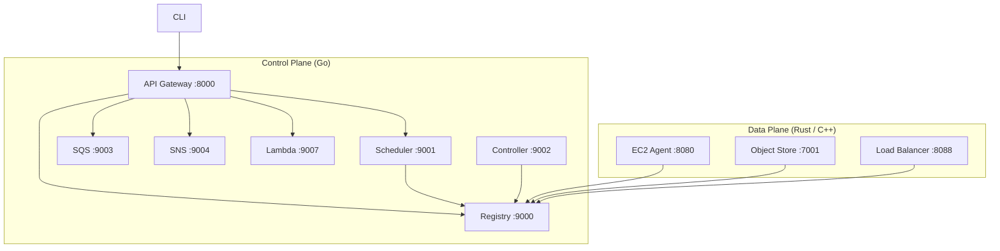
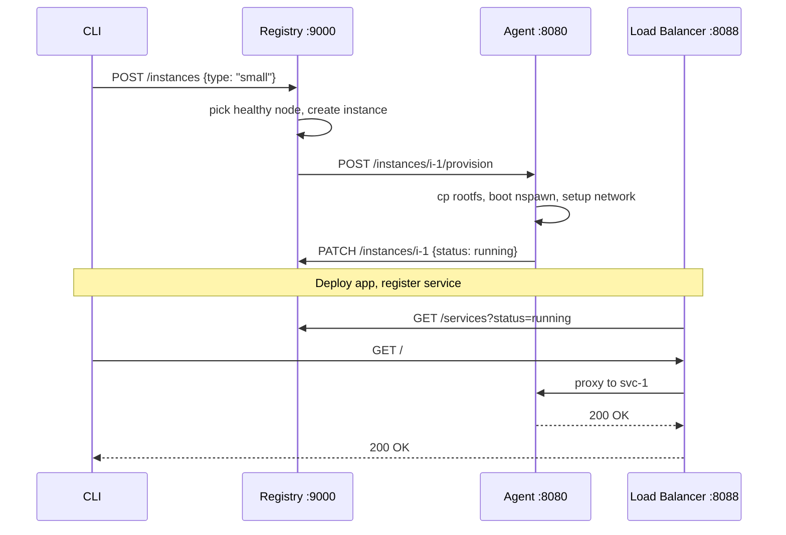

You've learned how Linux isolates processes and how networks move packets. Now we build a cloud.

tiny-aws is a miniature AWS. It runs real containers on real Linux machines, with a real scheduler, a real object store, a real message queue, and a real load balancer. It is not a simulation. It is not a mock. But it fits on one laptop.

This chapter is the map. We'll cover every service, every port, every language choice, and the dependency graph that dictates startup order. No code yet -- that starts in Chapter 22.

---

## Three layers



**User layer.** The CLI or any HTTP client.

**Control plane.** Nine Go services that manage state. The registry tracks what exists. The scheduler assigns work. The controller cleans up. SQS and SNS handle messaging. The API gateway provides a single entry point.

**Data plane.** Three services that do the real work. The EC2 agent (Rust) runs containers. The object store (Rust + C++) stores files. The load balancer (Go) routes HTTP traffic.

---

## What each service does

| Service | Port | What it does |
|---------|------|-------------|
| Registry | :9000 | Node registry, instance records, IAM keys, service tracking |
| Scheduler | :9001 | Job queue, node assignment, retry logic |
| Controller | :9002 | Workspace cleanup, reconciliation loop for terminated instances |
| SQS | :9003 | Message queue with visibility timeouts and dead letter queues |
| SNS | :9004 | Event pub/sub with topic-based fan-out |
| Networking | :9005 | VPC, subnet, security group, and route table metadata |
| Metadata | :9006 | Resource aggregator that queries all other services |
| Lambda | :9007 | Function creation, invocation, and event trigger wiring |
| API Gateway | :8000 | Reverse proxy that routes /v1/* to the right backend |
| EC2 Agent | :8080 | Compute agent that provisions and manages containers on each machine |
| Object Store | :7001 | S3-compatible storage with C++ block engine and Rust HTTP server |
| Load Balancer | :8088 | Round-robin reverse proxy that discovers backends from the registry |

Twelve services. Twelve ports. Every one of them is a standalone binary with its own HTTP server.

---

## Language choices

**Go for the control plane.** The registry, scheduler, controller, SQS, SNS, networking, metadata, lambda, and API gateway are all Go. Go compiles fast, has a good standard library HTTP server, and the code reads like pseudocode. The registry is 268 lines. The controller is 104 lines. You can read each service in one sitting.

**Rust for the data plane.** The EC2 agent and the object store HTTP layer are Rust. The agent needs to shell out to `systemd-nspawn`, manage child processes, handle async I/O, and survive crashes gracefully. Rust's ownership model and tokio's async runtime make this straightforward. The agent does raw TCP parsing for its HTTP server -- no framework, no dependencies beyond tokio and serde.

**C++ for the storage engine.** The object store's block engine is C++. It does direct filesystem I/O with `std::fstream` and `std::filesystem`. The Rust layer calls into it via a C FFI boundary. This split is educational -- it demonstrates how a low-level storage engine sits behind a higher-level API server, the same pattern used in production storage systems.

---

## SQLite everywhere

Six of the twelve services use SQLite:

- **Registry** -- `registry.db` stores nodes, instances, services, and IAM keys
- **Scheduler** -- `scheduler.db` stores jobs and their status
- **SQS** -- `sqs.db` stores queues and messages
- **SNS** -- `sns.db` stores topics and subscriptions
- **Lambda** -- `lambda.db` stores functions and triggers
- **Object Store** -- `metadata.db` stores object metadata (size, etag, content-type)

SQLite is the right lazy choice for three reasons:

1. **Zero setup.** No daemon, no config, no port. Open a file, run queries.
2. **Persistence across restarts.** Instance IDs, message sequences, and job history survive a reboot. The registry loads all nodes from SQLite on startup and resumes where it left off.
3. **UPSERT.** Every store uses `INSERT ... ON CONFLICT DO UPDATE`. Registration is idempotent. Heartbeats are idempotent. You can restart any service and it reconverges.

The registry's `NodeStore.Save` demonstrates the pattern:

```go
func (s *NodeStore) Save(node Node) error {
    _, err := s.db.Exec(
        `INSERT INTO nodes (id, hostname, addr, cpu_count, role, status, last_seen)
         VALUES (?, ?, ?, ?, ?, ?, ?)
         ON CONFLICT(id) DO UPDATE SET
           hostname = excluded.hostname,
           addr = excluded.addr,
           cpu_count = excluded.cpu_count,
           role = excluded.role,
           status = excluded.status,
           last_seen = excluded.last_seen`,
        node.ID, node.Hostname, node.Addr, node.CPUCount,
        node.Role, node.Status, node.LastSeen.Format(time.RFC3339),
    )
    return err
}
```

First call inserts. Subsequent calls update. No "check if exists" logic needed.

The tradeoff: SQLite is single-writer. Under high concurrent writes, WAL mode helps but does not eliminate contention. For a 1-3 machine cluster, this is irrelevant. For a 100-machine cluster, you would need PostgreSQL or etcd.

---

## Service discovery

There is no DNS. There is no service mesh. There is no Consul. Services find each other through environment variables:

```rust
pub fn registry_url() -> String {
    std::env::var("REGISTRY_URL").unwrap_or_else(|_| "http://127.0.0.1:9000".into())
}

pub fn scheduler_url() -> String {
    std::env::var("SCHEDULER_URL").unwrap_or_else(|_| "http://127.0.0.1:9001".into())
}

pub fn object_store_url() -> String {
    std::env::var("OBJECT_STORE_URL").unwrap_or_else(|_| "http://127.0.0.1:7001".into())
}
```

Every service defaults to `127.0.0.1` and its well-known port. For a single machine, you set nothing. For multi-machine, you set the env vars to point at the control plane host.

The variables used across the system:

| Variable | Used by | Points to |
|----------|---------|-----------|
| `REGISTRY_URL` | Agent, scheduler, controller, LB, object store | Registry :9000 |
| `SCHEDULER_URL` | Agent | Scheduler :9001 |
| `OBJECT_STORE_URL` | Agent, Lambda | Object Store :7001 |
| `SNS_URL` | Registry, object store | SNS :9004 |
| `SQS_URL` | Scheduler | SQS :9003 |
| `TINYAWS_API_KEY` | All services | Shared secret for auth |

This is the simplest possible service discovery. It works because the topology is static. The registry doesn't move. The scheduler doesn't move. If you need dynamic discovery, you need a different system.

---

## Start order

The dependency graph has one root: the registry. Start it first, then agents, then everything else.

1. **Registry (:9000)** -- everything registers with it or polls it.
2. **EC2 Agent (:8080)** -- registers, starts heartbeating. Must exist before the scheduler has nodes to schedule onto.
3. **Object Store (:7001)** -- registers as a storage node. Must exist before deploys upload artifacts.
4. **Scheduler (:9001)** -- polls the registry for healthy nodes.
5. **Controller (:9002)** -- polls for terminated instances, cleans up workspaces.
6. **SQS (:9003) / SNS (:9004)** -- standalone. Start in any order.
7. **Load Balancer (:8088)** -- polls for running services. Start last.

Between each startup, the run script waits for the port:

```bash
wait_for_port() {
    local port=$1
    local retries=30
    while ! nc -z 127.0.0.1 "$port" 2>/dev/null; do
        retries=$((retries - 1))
        if [ "$retries" -le 0 ]; then exit 1; fi
        sleep 1
    done
}
```

---

## The basic flow



CLI talks to the registry. Registry talks to the agent. Agent does the work and reports back. The load balancer discovers the result by polling.

---

## What is not here

No auto-scaling. No multi-region. No IAM policies beyond admin/readonly. No CloudFormation. No billing. No TLS between services. tiny-aws gives you the skeleton and leaves the rest as exercises.

---

We start with the registry -- the service everything else depends on.
