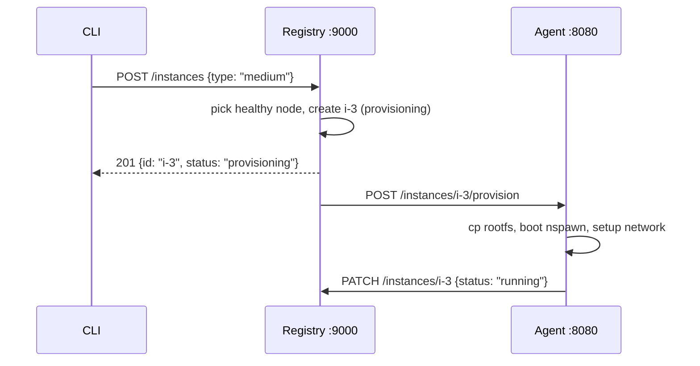

Every cloud has a source of truth. In AWS, it's a constellation of distributed databases behind every service. In tiny-aws, it's one Go binary and one SQLite file.

The registry lives in `control-plane/registry/`. It tracks three things: which machines exist, which instances are running on them, and which services are deployed.

---

## The Node struct

Every machine that joins the cluster is a Node:

```go
type Node struct {
    ID       string    `json:"id"`
    Hostname string    `json:"hostname"`
    Addr     string    `json:"addr"`
    CPUCount int       `json:"cpu_count"`
    Role     string    `json:"role"`
    Status   string    `json:"status"`
    LastSeen time.Time `json:"last_seen"`
}
```

`ID` is set by the agent, usually the hostname. `Addr` is the routable IP set via `AGENT_ADVERTISE_ADDR` -- on multi-machine clusters, this must be the real IP so the load balancer and registry can reach the agent. `Role` is `compute` for agents or `storage` for object store nodes. `Status` is `healthy` or `unhealthy`, driven by the heartbeat cycle.

---

## Registration: agent POSTs to /nodes/register

```go
func handleRegister(w http.ResponseWriter, r *http.Request) {
    var node Node
    if err := json.NewDecoder(r.Body).Decode(&node); err != nil {
        http.Error(w, "failed to decode node", http.StatusBadRequest)
        return
    }
    if node.Role == "" {
        node.Role = "compute"
    }
    node.Status = "healthy"
    node.LastSeen = time.Now()

    nodesMu.Lock()
    nodes[node.ID] = node
    nodesMu.Unlock()

    if err := store.Save(node); err != nil {
        http.Error(w, "failed to persist node", http.StatusInternalServerError)
        return
    }
    w.WriteHeader(http.StatusCreated)
    json.NewEncoder(w).Encode(node)
}
```

Set status to healthy, store in the in-memory map, persist to SQLite. The node is immediately available for scheduling. Registration is unauthenticated -- agents need to register before they have credentials.

---

## Heartbeat: agent POSTs every 10 seconds

Each heartbeat updates `LastSeen` and flips `Status` back to `healthy`:

```go
nodesMu.Lock()
node, exists := nodes[heartbeat.ID]
if exists {
    node.LastSeen = time.Now()
    node.Status = "healthy"
    nodes[heartbeat.ID] = node
    store.Save(node)
}
nodesMu.Unlock()
```

If the node ID is not found (registry restarted, node was pruned), the heartbeat returns 404. The agent should re-register.

---

## Health check loop: checkNodesHealth()

A background goroutine checks every node's `LastSeen` every 10 seconds:

```go
func checkNodesHealth() {
    ticker := time.NewTicker(10 * time.Second)
    defer ticker.Stop()
    for range ticker.C {
        now := time.Now()
        nodesMu.Lock()
        for id, node := range nodes {
            age := now.Sub(node.LastSeen)
            if age > 5*time.Minute && node.Status == "unhealthy" {
                delete(nodes, id)
                store.Delete(id)
                continue
            }
            if age > 30*time.Second {
                node.Status = "unhealthy"
                nodes[id] = node
                store.Save(node)
            }
        }
        nodesMu.Unlock()
    }
}
```

Two thresholds. **30 seconds** without a heartbeat: mark unhealthy. The scheduler stops picking this node. **5 minutes** without a heartbeat, already unhealthy: prune from the map and SQLite. The gap gives a machine time to recover from a network blip.

---

## NodeStore: SQLite persistence with UPSERT

```sql
CREATE TABLE IF NOT EXISTS nodes (
    id         TEXT PRIMARY KEY,
    hostname   TEXT NOT NULL,
    addr       TEXT NOT NULL DEFAULT '',
    cpu_count  INTEGER NOT NULL,
    role       TEXT NOT NULL,
    status     TEXT NOT NULL,
    last_seen  TEXT NOT NULL
);
```

All four stores -- nodes, instances, services, IAM keys -- share a single `registry.db` file through the same `*sql.DB` handle. On startup, the registry loads everything into memory:

```go
store = NewNodeStore("registry.db")
instanceStore = NewInstanceStore(store.DB())
serviceStore = NewServiceStore(store.DB())
nodes = store.LoadAll()
instances = instanceStore.LoadAll()
```

---

## Instance records

```go
type Instance struct {
    ID           string    `json:"id"`
    NodeID       string    `json:"node_id"`
    Status       string    `json:"status"`
    InstanceType string    `json:"instance_type"`
    CPULimit     string    `json:"cpu_limit"`
    MemLimitMB   int       `json:"mem_limit_mb"`
    BaseImage    string    `json:"base_image,omitempty"`
    CreatedAt    time.Time `json:"created_at"`
}
```

Instance types map to cgroup resource limits:

```go
var instanceTypeSpec = map[string][2]interface{}{
    "nano":   {"25%", 128},
    "micro":  {"50%", 256},
    "small":  {"100%", 512},
    "medium": {"200%", 1024},
    "large":  {"400%", 2048},
}
```

`CPULimit` is a cgroup CPU quota. `100%` = one core. `200%` = two cores. `MemLimitMB` is the cgroup memory cap. These pass directly to `systemd-run --property=CPUQuota=... --property=MemoryMax=...` on the agent. IDs are sequential (`i-1`, `i-2`, ...) and the sequence counter persists across restarts by reading the highest existing ID from SQLite.

---

## launchInstance: pick node, create instance, call agent

```go
func launchInstance(w http.ResponseWriter, r *http.Request) {
    var req struct{ InstanceType string `json:"instance_type"` }
    json.NewDecoder(r.Body).Decode(&req)

    node, err := pickHealthyComputeNodeLocal()
    if err != nil {
        http.Error(w, err.Error(), http.StatusServiceUnavailable)
        return
    }
    inst := instanceStore.Create(node.ID, req.InstanceType)
    instancesMu.Lock()
    instances = append(instances, inst)
    instancesMu.Unlock()

    go provisionOnAgent(*node, inst)

    w.WriteHeader(http.StatusCreated)
    json.NewEncoder(w).Encode(inst)
}
```

`pickHealthyComputeNodeLocal` filters to `role=compute, status=healthy` and returns the first one. `provisionOnAgent` runs in a goroutine so the HTTP response returns immediately with `status: provisioning`. The agent PATCHes the registry when the container is ready.

```go
func provisionOnAgent(node Node, inst Instance) {
    host := node.Addr
    if host == "" { host = node.Hostname }
    url := fmt.Sprintf("http://%s:8080/instances/%s/provision", host, inst.ID)
    payload, _ := json.Marshal(inst)
    resp, err := http.Post(url, "application/json", bytes.NewReader(payload))
    if err != nil {
        instanceStore.SetStatus(inst.ID, "failed")
        return
    }
    resp.Body.Close()
}
```



---

## Services table: how deployed apps are tracked

```go
type Service struct {
    ID         string    `json:"id"`
    InstanceID string    `json:"instance_id"`
    NodeID     string    `json:"node_id"`
    Port       int       `json:"port"`
    PID        int       `json:"pid"`
    Status     string    `json:"status"`
    DeployURL  string    `json:"deploy_url"`
    CreatedAt  time.Time `json:"created_at"`
}
```

The agent registers a service after spawning a process. The load balancer polls `GET /services?status=running` to discover backends. Service IDs are sequential: `svc-1`, `svc-2`, `svc-3`.

---

The registry is a single point of failure. If it dies, no new work can be scheduled. Running instances continue, but the system is blind. That's fine for 1-3 machines.
