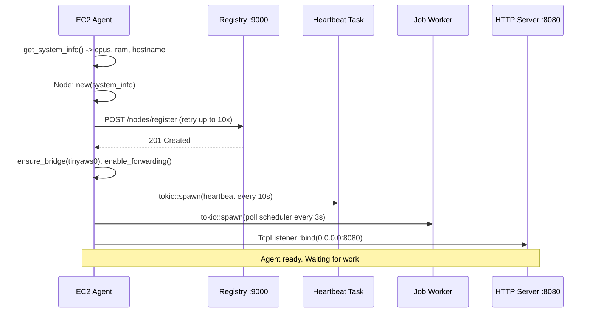

The registry is a ledger. The agent is the worker. Every machine that runs containers needs one.

The ec2-agent lives in `data-plane/compute/ec2-agent/`. It is a Rust binary built with tokio. On startup it reads hardware info, registers with the registry, spawns background tasks for heartbeating and job polling, sets up a network bridge, and starts an HTTP server.

---

## Module layout

```rust
mod builder;
mod config;
mod heartbeat;
mod instances;
mod jobs;
mod networking;
mod node;
mod registry;
mod sandbox;
mod server;
mod system;
```

Eleven modules, each with one job. `config` reads env vars. `system` reads CPU/RAM via sysinfo. `node` defines the identity structs. `registry` handles registration with retry. `heartbeat` pings the registry every 10s. `server` runs raw TCP HTTP. `instances` provisions and destroys nspawn containers. `jobs` polls the scheduler. `networking` manages the bridge and veth pairs. `sandbox` applies cgroup limits and seccomp. `builder` parses `tinyaws.build` and caches rootfs images.

---

## System discovery

```rust
#[derive(Debug, Serialize, Clone)]
pub struct SystemInfo {
    pub hostname:            String,
    pub cpu_count:           usize,
    pub memory_total_mb:     u64,
    pub memory_available_mb: u64,
    pub operating_system:    String,
    pub architecture:        String,
}

pub fn get_system_info() -> SystemInfo {
    let mut system = System::new_all();
    system.refresh_all();
    let hostname = hostname::get()
        .map(|name| name.to_string_lossy().to_string())
        .unwrap_or_else(|_| "unknown".to_string());
    SystemInfo {
        hostname,
        cpu_count: num_cpus::get(),
        memory_total_mb: system.total_memory() / 1024 / 1024,
        memory_available_mb: system.available_memory() / 1024 / 1024,
        operating_system: System::long_os_version().unwrap_or_else(|| "unknown".to_string()),
        architecture: System::cpu_arch(),
    }
}
```

Runs once at startup. CPU count goes to the registry. Memory info is logged but not used for scheduling -- instance placement is based on type specs, not available RAM.

---

## Registration: register_with_retry

```rust
pub async fn register_with_retry(
    registry_url: &str,
    registration: &NodeRegistration,
) -> Result<(), reqwest::Error> {
    let client = reqwest::Client::new();
    let url = format!("{}/nodes/register", registry_url);
    for attempt in 1..=10 {
        match client.post(&url).json(registration).send().await {
            Ok(response) => match response.error_for_status() {
                Ok(_) => return Ok(()),
                Err(e) => eprintln!("register attempt {} failed: {}", attempt, e),
            },
            Err(e) => eprintln!("register attempt {} failed: {}", attempt, e),
        }
        tokio::time::sleep(Duration::from_secs(2)).await;
    }
    // final attempt -- propagate error on failure
    client.post(&url).json(registration).send().await?.error_for_status()?;
    Ok(())
}
```

10 attempts, 2 seconds apart. The registry might not be ready when the agent starts. After 20+ seconds of failure, the final attempt propagates the error and crashes the process.

---

## Config: env vars with defaults

```rust
pub fn registry_url() -> String {
    std::env::var("REGISTRY_URL").unwrap_or_else(|_| "http://127.0.0.1:9000".into())
}
pub fn scheduler_url() -> String {
    std::env::var("SCHEDULER_URL").unwrap_or_else(|_| "http://127.0.0.1:9001".into())
}
pub fn object_store_url() -> String {
    std::env::var("OBJECT_STORE_URL").unwrap_or_else(|_| "http://127.0.0.1:7001".into())
}
```

On a single machine, set nothing. On multi-machine, point these at the control plane host. Additional vars: `AGENT_ADDR` (bind address, default `0.0.0.0:8080`), `AGENT_ADVERTISE_ADDR` (routable address for other services), `TINYAWS_ROOTFS_BASE` (base rootfs path), `TINYAWS_INSTANCES_DIR` (per-instance rootfs dir).

---

## Heartbeat: tokio background task, every 10 seconds

```rust
pub fn start_heartbeat(node_id: String, registry_url: &str) {
    let client = reqwest::Client::new();
    let heartbeat = Heartbeat::new(node_id);
    let registry_url = registry_url.to_string();
    tokio::spawn(async move {
        let mut ticker = interval(Duration::from_secs(10));
        loop {
            ticker.tick().await;
            let url = format!("{}/nodes/heartbeat", registry_url);
            if let Err(e) = client.post(&url).json(&heartbeat).send().await {
                eprintln!("heartbeat failed: {}", e);
            }
        }
    });
}
```

Runs forever. If the registry is down, heartbeats fail silently and retry on the next tick. After 30 seconds of missed heartbeats, the registry marks this node unhealthy. When heartbeats resume, it flips back.

---

## HTTP server: raw TCP

No axum, no hyper. The agent parses HTTP by hand:

```rust
pub async fn start(node: &Node) -> Result<(), Box<dyn std::error::Error>> {
    let addr = std::env::var("AGENT_ADDR").unwrap_or_else(|_| "0.0.0.0:8080".into());
    let listener = TcpListener::bind(&addr).await?;
    loop {
        let (mut socket, _) = listener.accept().await?;
        let node_json = to_string(node).unwrap_or_default();
        tokio::spawn(async move {
            let mut buffer = vec![0u8; 65536];
            let n = socket.read(&mut buffer).await.unwrap_or(0);
            let raw = String::from_utf8_lossy(&buffer[..n]);
            let first = raw.lines().next().unwrap_or("");
            let mut parts = first.split_whitespace();
            let method = parts.next().unwrap_or("GET");
            let path = parts.next().unwrap_or("/");
            let body = raw.find("\r\n\r\n").map(|i| raw[i+4..].trim()).unwrap_or("");

            let (status, resp_body) = handle_request(method, path, body, &node_json);
            let resp = format!(
                "HTTP/1.1 {}\r\nContent-Type: application/json\r\nContent-Length: {}\r\nConnection: close\r\n\r\n{}",
                status, resp_body.len(), resp_body
            );
            let _ = socket.write_all(resp.as_bytes()).await;
        });
    }
}
```

Four routes: `GET /health` (200, static JSON), `GET /info` (node struct), `POST /instances/{id}/provision` (spawn provisioning thread, return 202), `DELETE /instances/{id}` (stop container, return 204). Everything else returns 404.

---

## The startup sequence



The order matters: system info first (need CPU count for registration), register second (must exist in registry before work is scheduled), bridge third (instances need it for networking), background tasks fourth, HTTP server last (it blocks).

```rust
#[tokio::main]
async fn main() -> Result<(), Box<dyn std::error::Error>> {
    let registry_url = config::registry_url();
    let scheduler_url = config::scheduler_url();
    let system_info = system::get_system_info();
    let node = node::Node::new(system_info);
    let registration = NodeRegistration::from_node(&node);

    registry::register_with_retry(&registry_url, &registration).await?;

    #[cfg(unix)]
    { networking::ensure_bridge(); networking::enable_forwarding(); }

    heartbeat::start_heartbeat(node.id.clone(), &registry_url);
    jobs::start_job_worker(node.id.clone(), scheduler_url, registry_url.clone());

    tokio::select! {
        _ = server::start(&node) => {}
        _ = signal::ctrl_c() => { println!("shutting down..."); }
    }
    Ok(())
}
```

---

## AGENT_ADVERTISE_ADDR -- why hostname fails on multi-machine

```rust
let addr = std::env::var("AGENT_ADVERTISE_ADDR")
    .unwrap_or_else(|_| node.system.hostname.clone());
```

On a single machine, the hostname resolves to `127.0.0.1`. On a multi-machine cluster, the hostname might not resolve from other machines at all. Set `AGENT_ADVERTISE_ADDR=192.168.1.50` (the machine's real IP) and the registry, load balancer, and provisioning calls all use that address. Same pattern as Kubernetes `--advertise-address` and Consul `advertise_addr`.

---

The agent is now registered, heartbeating, and listening for work. Next: what happens when someone says "launch an instance."
