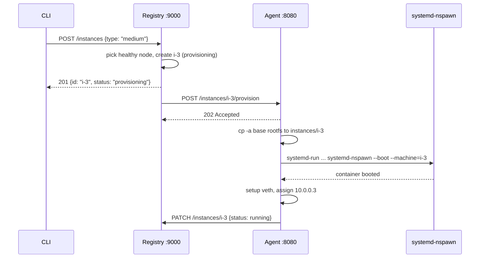

You type `tinyaws instance launch --type medium`. Thirty seconds later, there's a real Linux container with its own filesystem, network interface, and resource limits. Here's every step.

---

## Steps 1-3: CLI to registry

The CLI sends `POST /instances` with `{"instance_type": "medium"}`. The registry picks the first healthy compute node, creates an instance record with status `provisioning`, persists it to SQLite, and returns 201 immediately. A goroutine calls the agent's provision endpoint in the background. If the agent is unreachable, the instance is marked `failed`.

---

## Step 4: Agent receives the provision request

The agent deserializes the spec, spawns a background thread, and returns 202:

```rust
#[derive(Debug, Deserialize)]
pub struct InstanceSpec {
    pub id: String,
    pub cpu_limit: String,
    pub mem_limit_mb: u64,
    pub instance_type: String,
    #[serde(default)]
    pub base_image: String,
    #[serde(default)]
    pub volumes: Vec<String>,
}
```

The thread runs `instances::provision(&spec)` and PATCHes the registry when done.

---

## Step 5: Clone the rootfs

The base rootfs was created once by `bootstrap-rootfs.sh` (debootstrap). The agent copies it for each instance:

```rust
pub fn provision(spec: &InstanceSpec) -> Result<(), String> {
    let base = if spec.base_image.is_empty() {
        rootfs_base()   // /var/lib/tinyaws/base
    } else {
        PathBuf::from(&spec.base_image)
    };
    let dest = rootfs_path(&spec.id);  // /var/lib/tinyaws/instances/i-3

    if !base.exists() {
        return Err(format!("base rootfs not found at {}", base.display()));
    }
    if dest.exists() {
        return Ok(());  // already provisioned
    }

    let status = std::process::Command::new("cp")
        .args(["-a", base.to_str().unwrap(), dest.to_str().unwrap()])
        .status()
        .map_err(|e| format!("cp failed: {}", e))?;
    if !status.success() {
        return Err("cp base rootfs failed".into());
    }
    // ...
```

`cp -a` does a full recursive copy preserving permissions and symlinks. A production system would use overlayfs for instant copy-on-write cloning. `cp -a` is simpler to debug.

---

## Step 6: Boot with systemd-nspawn

```rust
    let mut nspawn_args = vec![
        "--unit".to_string(), format!("tinyaws-{}", spec.id),
        format!("--property=CPUQuota={}", spec.cpu_limit),
        format!("--property=MemoryMax={}M", spec.mem_limit_mb),
        "--".to_string(),
        "systemd-nspawn".to_string(),
        "--boot".to_string(),
        format!("--machine={}", spec.id),
        format!("--directory={}", dest.display()),
        "--network-veth".to_string(),
        "--resolv-conf=copy-host".to_string(),
    ];
    for vol in &spec.volumes {
        nspawn_args.push(format!("--bind={}", vol));
    }
    std::process::Command::new("systemd-run")
        .args(&nspawn_args)
        .status()
        .map_err(|e| format!("systemd-run failed: {}", e))?;
```

Two tools working together. **systemd-run** creates a transient unit with cgroup limits (`CPUQuota=200%`, `MemoryMax=1024M`). **systemd-nspawn** boots the container with `--boot` (runs init), `--machine=i-3` (registers with machinectl), `--network-veth` (network isolation), `--resolv-conf=copy-host` (DNS). The container gets its own PID, mount, and network namespaces.

---

## Step 7: Networking

After the container boots, the agent sets up networking:

```rust
pub fn setup_instance_network(instance_id: &str, instance_seq: u16) -> Result<String, String> {
    let veth_host = format!("veth-{}", &instance_id[..instance_id.len().min(8)]);
    let veth_inst = format!("veth-{}-i", &instance_id[..instance_id.len().min(6)]);
    let ip = format!("10.0.0.{}", instance_seq);
    let ip_cidr = format!("{}/16", ip);

    run_cmd("ip", &["link", "add", &veth_host, "type", "veth", "peer", "name", &veth_inst])?;
    run_cmd("ip", &["link", "set", &veth_host, "master", BRIDGE_NAME])?;
    run_cmd("ip", &["link", "set", &veth_host, "up"])?;
    run_cmd("ip", &["addr", "add", &ip_cidr, "dev", &veth_inst])?;
    run_cmd("ip", &["link", "set", &veth_inst, "up"])?;

    Ok(ip)
}
```

Instance `i-3` gets IP `10.0.0.3` on the `tinyaws0` bridge (`10.0.0.1/16`). Networking failures are non-fatal.

---

## Step 8: Agent PATCHes status

```rust
let status = match instances::provision(&spec) {
    Ok(_) => "running",
    Err(e) => { eprintln!("provision {}: {}", inst_id, e); "failed" }
};
let url = format!("{}/instances/{}", registry_url, inst_id);
let payload = format!(r#"{{"status":"{}"}}"#, status);
let _ = ureq::patch(&url).set("content-type", "application/json").send_string(&payload);
```

---

## The complete flow



---

## tinyaws.build: custom images

For deploys that need specific packages, the agent supports a build file:

```
base: ubuntu
packages: python3 python3-pip
run: pip install -r requirements.txt
start: python3 app.py
```

The `builder.rs` module parses it, builds a rootfs (copy base, chroot, apt-get install, run build commands), and caches the result by content hash:

```rust
pub fn build_image(spec: &BuildSpec) -> Result<PathBuf, String> {
    let hash = spec.content_hash();
    let image_path = images_dir().join(&hash);
    if image_path.join("usr").exists() {
        println!("builder: using cached image {}", hash);
        return Ok(image_path);
    }
    // copy base rootfs, install packages via chroot, run build commands
    Ok(image_path)
}
```

Identical build files share the same cached image. The second deploy skips the build entirely.

---

## Termination

`tinyaws instance terminate i-3` triggers `DELETE /instances/i-3`. The registry marks it terminated and calls `DELETE /instances/i-3` on the agent:

```rust
pub fn destroy(instance_id: &str) {
    crate::networking::teardown_instance_network(instance_id);
    let _ = std::process::Command::new("machinectl")
        .args(["poweroff", instance_id]).status();
    std::thread::sleep(std::time::Duration::from_secs(3));
    let _ = std::process::Command::new("machinectl")
        .args(["terminate", instance_id]).status();
    let path = rootfs_path(instance_id);
    if path.exists() { let _ = std::fs::remove_dir_all(&path); }
}
```

Tear down the veth pair. Ask systemd to power off gracefully. Wait 3 seconds. Force-terminate. Delete the rootfs. The controller (Chapter 30) provides a safety net by polling for terminated instances and cleaning up anything the agent missed.

---

The container is running. It has its own PID namespace, its own filesystem, its own resource limits. But it doesn't have a network yet -- or a job to run. Those come next.
