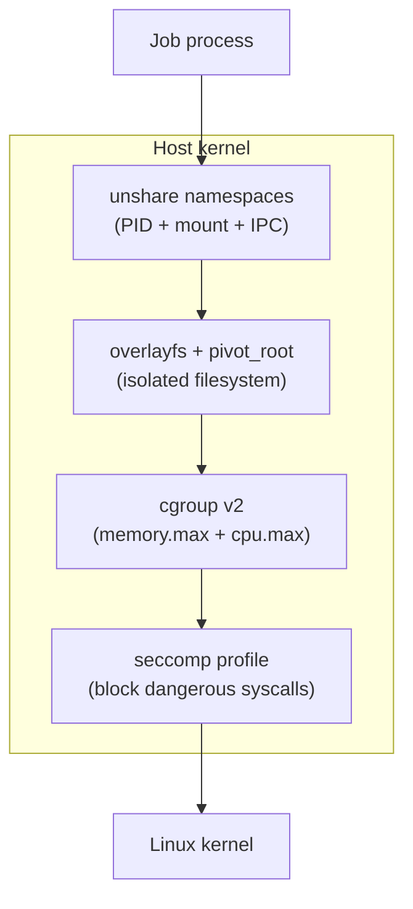

The container is running. It has its own filesystem, a CPU quota, a memory cap. But it can still `ps aux` the host, mount arbitrary disks, and call any syscall the kernel exposes. The sandbox fixes each of those, using nothing but Linux primitives.

The whole thing lives in `data-plane/compute/ec2-agent/src/sandbox.rs`. Roughly 250 lines of Rust (plus tests). No Docker. No runc.

---

## enabled() -- the kill switch

```rust
pub fn enabled() -> bool {
    #[cfg(not(unix))]
    return false;

    #[cfg(unix)]
    {
        let v = std::env::var("TINYAWS_SANDBOX").unwrap_or_else(|_| "1".into());
        v != "0"
    }
}
```

On Linux, sandboxing is on by default. Set `TINYAWS_SANDBOX=0` to disable it. On non-Unix, it compiles to `return false` and every downstream call becomes a passthrough.

---

## wrap_command() -- namespace isolation

Every job command runs through `wrap_command()`. When enabled, it prepends `unshare` with five flags:

```rust
pub fn wrap_command(prog: &str, args: &[&str]) -> (String, Vec<String>) {
    if !enabled() {
        return (prog.into(), args.iter().map(|s| s.to_string()).collect());
    }

    let mut wrapped_args: Vec<String> = vec![
        "--pid".into(),  "--mount".into(), "--ipc".into(),
        "--fork".into(), "--mount-proc".into(), "--".into(),
    ];
    wrapped_args.push(prog.into());
    for a in args { wrapped_args.push(a.to_string()); }

    ("unshare".into(), wrapped_args)
}
```

| Flag | Effect |
|---|---|
| `--pid` | New PID namespace. The process cannot see host processes. |
| `--mount` | New mount namespace. Mounts do not leak to the host. |
| `--ipc` | New IPC namespace. Shared memory segments are isolated. |
| `--fork` | The unshared process becomes PID 1 inside the new namespace. |
| `--mount-proc` | Mounts a new `/proc` filtered to the new PID namespace. |

`echo hello` becomes `unshare --pid --mount --ipc --fork --mount-proc -- echo hello`. The process sees itself as PID 1, cannot kill host processes, and has its own mount table.

---

## wrap_command_with_rootfs() -- filesystem isolation

Namespaces isolate processes and mounts, but the process still shares the host filesystem. This function adds overlayfs and `pivot_root`:

```rust
pub fn wrap_command_with_rootfs(
    prog: &str, args: &[&str],
    image_path: &Path, app_dir: &Path, scratch_dir: &Path,
) -> (String, Vec<String>) {
    let upper = scratch_dir.join("upper");
    let work = scratch_dir.join("work");
    let merged = scratch_dir.join("merged");
    let old_root = merged.join("old_root");
```

It generates a shell script that runs inside `unshare`:

```bash
set -e
mkdir -p '.../upper' '.../work' '.../merged' '.../merged/old_root'
mount -t overlay overlay \
  -o 'lowerdir=/var/lib/tinyaws/images/abc123,upperdir=.../upper,workdir=.../work' \
  '.../merged'
cp -a '/deploy/dir/.' '.../merged/app/' 2>/dev/null || true
cd '.../merged'
pivot_root . old_root
cd /app
umount -l /old_root 2>/dev/null || true
rmdir /old_root 2>/dev/null || true
exec python3 app.py
```

Step by step: mount overlayfs (read-only image as lower, writable upper for changes), copy app code into `/app`, `pivot_root` so the merged directory becomes `/`, unmount the old root. After `pivot_root`, the process cannot see the host filesystem at all. The whole script is wrapped in `unshare --pid --mount --ipc --fork --mount-proc --`.

---

## setup_cgroup() -- resource limits

Namespaces isolate what a process can see. Cgroups limit what it can consume:

```rust
pub fn setup_cgroup(job_id: &str, mem_limit_mb: u64, cpu_percent: u64) -> Option<String> {
    #[cfg(not(unix))]
    { return None; }

    #[cfg(unix)]
    {
        let cgroup_base = "/sys/fs/cgroup/tinyaws";
        let cgroup_path = format!("{}/{}", cgroup_base, job_id);

        let _ = std::fs::create_dir_all(cgroup_base);
        if std::fs::create_dir_all(&cgroup_path).is_err() { return None; }

        // memory.max in bytes
        if mem_limit_mb > 0 {
            let mem_bytes = mem_limit_mb * 1024 * 1024;
            let _ = std::fs::write(format!("{}/memory.max", cgroup_path), mem_bytes.to_string());
        }

        // cpu.max: <quota> <period> in microseconds
        if cpu_percent > 0 {
            let quota = cpu_percent * 1000;
            let period = 100_000u64;
            let _ = std::fs::write(format!("{}/cpu.max", cgroup_path), format!("{} {}", quota, period));
        }

        Some(cgroup_path)
    }
}
```

Two files written to `/sys/fs/cgroup/tinyaws/{job_id}/`:

- **`memory.max`**: hard limit in bytes. 512 MB for run-once jobs, 1024 MB for services. Exceed it and the OOM killer fires.
- **`cpu.max`**: `{quota} {period}` in microseconds. `100000 100000` = 100% of one core. `200000 100000` = two cores. The kernel throttles when quota is exhausted within the period.

---

## seccomp -- syscall filtering

Even with namespaces and cgroups, a process can call `reboot(2)` or `kexec_load(2)`. A seccomp profile blocks dangerous syscalls. The agent searches three paths in order:

```rust
fn seccomp_profile_path() -> Option<String> {
    // 1. TINYAWS_SECCOMP_PROFILE env var
    if let Ok(p) = std::env::var("TINYAWS_SECCOMP_PROFILE") {
        if Path::new(&p).exists() { return Some(p); }
    }
    // 2. seccomp-default.json next to the binary
    if let Ok(exe) = std::env::current_exe() {
        if let Some(dir) = exe.parent() {
            let candidate = dir.join("seccomp-default.json");
            if candidate.exists() { return Some(candidate.to_string_lossy().into_owned()); }
        }
    }
    // 3. /etc/tinyaws/seccomp-default.json
    let system = "/etc/tinyaws/seccomp-default.json";
    if Path::new(system).exists() { return Some(system.into()); }
    None
}
```

For nspawn instances, the profile is passed as `--seccomp-profile=`. If no profile exists, seccomp is silently skipped. The other layers still apply.

---

## Cleanup

```rust
pub fn cleanup_overlay(job_id: &str) {
    let scratch = format!("/tmp/tinyaws-overlay/{}", job_id);
    #[cfg(unix)]
    {
        let merged = format!("{}/merged", scratch);
        let _ = std::process::Command::new("umount").args(["-l", &merged]).status();
    }
    let _ = std::fs::remove_dir_all(&scratch);
}

pub fn cleanup_cgroup(job_id: &str) {
    #[cfg(unix)]
    {
        let cgroup_path = format!("/sys/fs/cgroup/tinyaws/{}", job_id);
        let _ = std::fs::remove_dir(&cgroup_path);
    }
}
```

Overlay: lazy unmount (`-l`) then delete scratch. Cgroup: `remove_dir` (not `remove_dir_all`) -- the kernel only allows removal when the cgroup has no processes.

---

## The full stack



Each layer is independent. No seccomp profile? Namespaces, cgroups, and overlayfs still work. No `tinyaws.build`? No overlayfs, but namespaces and cgroups still isolate. `TINYAWS_SANDBOX=0`? Everything off.

In `jobs.rs`, every job goes through the sandbox:

```rust
let _cgroup = crate::sandbox::setup_cgroup(&job.job_id, 512, 100);
let (exit_code, stdout, stderr) = run_command_in(&job.command, ...);
crate::sandbox::cleanup_cgroup(&job.job_id);
crate::sandbox::cleanup_overlay(&job.job_id);
```

---

250 lines. No Docker. No runc. Just Linux primitives wired together: `unshare` for namespaces, overlayfs for the filesystem, cgroup v2 files for resource limits, and a JSON profile for seccomp. Each one is a single function call. Each one can be disabled independently. Each one cleans up after itself.
