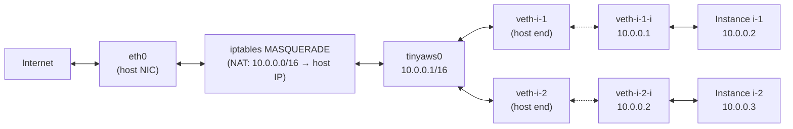

A container with no network is a box with no door. It can compute, but it cannot talk to anything -- not to other containers, not to the registry, not to the internet. The networking module gives each instance an IP address, a route to every other instance, and a path to the outside world.

The whole thing lives in `data-plane/compute/ec2-agent/src/networking.rs`. It is 106 lines of Rust. One bridge, one MASQUERADE rule, one veth pair per container.

---

## The constants

```rust
const BRIDGE_NAME: &str = "tinyaws0";
const BRIDGE_IP: &str = "10.0.0.1/16";
```

Every tinyaws agent creates a single Linux bridge called `tinyaws0` with IP `10.0.0.1/16`. The `/16` subnet gives 65,534 usable addresses -- far more than any single machine will need. The bridge acts as the default gateway for all containers on this host.

---

## ensure_bridge(): creating the bridge

Called once at agent startup, before any instances are provisioned:

```rust
pub fn ensure_bridge() -> Result<(), String> {
    // check if bridge already exists
    let status = Command::new("ip")
        .args(["link", "show", BRIDGE_NAME])
        .stdout(std::process::Stdio::null())
        .stderr(std::process::Stdio::null())
        .status()
        .map_err(|e| format!("ip link show: {}", e))?;

    if status.success() {
        return Ok(()); // already exists
    }

    // create bridge
    run_cmd("ip", &["link", "add", BRIDGE_NAME, "type", "bridge"])?;
    run_cmd("ip", &["addr", "add", BRIDGE_IP, "dev", BRIDGE_NAME])?;
    run_cmd("ip", &["link", "set", BRIDGE_NAME, "up"])?;

    println!("network: created bridge {} with {}", BRIDGE_NAME, BRIDGE_IP);
    Ok(())
}
```

Three `ip` commands:

1. **`ip link add tinyaws0 type bridge`** -- create a virtual bridge device. Think of it as a software switch.
2. **`ip addr add 10.0.0.1/16 dev tinyaws0`** -- assign the bridge an IP. This is the gateway address that containers will route through.
3. **`ip link set tinyaws0 up`** -- bring the interface up.

The idempotency check at the top (`ip link show tinyaws0`) means restarting the agent does not fail or duplicate the bridge. If it exists, the function returns immediately.

---

## setup_instance_network(): one veth pair per instance

Each instance gets a virtual ethernet pair -- one end on the host (attached to the bridge), one end for the instance:

```rust
pub fn setup_instance_network(instance_id: &str, instance_seq: u16) -> Result<String, String> {
    let veth_host = format!("veth-{}", &instance_id[..instance_id.len().min(8)]);
    let veth_inst = format!("veth-{}-i", &instance_id[..instance_id.len().min(6)]);
    let ip = format!("10.0.0.{}", instance_seq);
    let ip_cidr = format!("{}/16", ip);

    // create veth pair
    run_cmd("ip", &["link", "add", &veth_host, "type", "veth",
                     "peer", "name", &veth_inst])?;

    // attach host end to bridge
    run_cmd("ip", &["link", "set", &veth_host, "master", BRIDGE_NAME])?;
    run_cmd("ip", &["link", "set", &veth_host, "up"])?;

    // assign IP to instance end
    run_cmd("ip", &["addr", "add", &ip_cidr, "dev", &veth_inst])?;
    run_cmd("ip", &["link", "set", &veth_inst, "up"])?;

    println!("network: {} -> {} ({})", instance_id, ip, veth_host);
    Ok(ip)
}
```

The naming scheme truncates instance IDs to fit Linux's 15-character interface name limit. Instance `i-3` (sequence number 3) gets:

- `veth-i-3` on the host side, attached to the `tinyaws0` bridge
- `veth-i-3-i` on the instance side, with IP `10.0.0.3/16`

The five commands:

1. **`ip link add veth-i-3 type veth peer name veth-i-3-i`** -- create the pair. A veth pair is a virtual cable: packets sent into one end come out the other.
2. **`ip link set veth-i-3 master tinyaws0`** -- plug the host end into the bridge.
3. **`ip link set veth-i-3 up`** -- bring the host end up.
4. **`ip addr add 10.0.0.3/16 dev veth-i-3-i`** -- give the instance end an IP.
5. **`ip link set veth-i-3-i up`** -- bring the instance end up.

An honest note: in the non-nspawn path, the veth's instance end is not moved into the container's network namespace. The comment in the source says as much:

```rust
// For nspawn containers, we use machinectl to find the PID and use nsenter.
// For non-nspawn, we assign the IP directly to the veth.
```

For nspawn containers, `--network-veth` handles namespace assignment automatically. For bare-process sandbox jobs, the veth stays on the host. The IP is still reachable, but the process is not fully network-isolated.

---

## enable_forwarding(): internet access

A container on a bridge can talk to other containers on the same bridge. But it cannot reach the internet unless the host forwards its packets and masquerades them behind its own IP.

```rust
pub fn enable_forwarding() -> Result<(), String> {
    // enable IP forwarding
    let _ = std::fs::write("/proc/sys/net/ipv4/ip_forward", "1");

    // add masquerade rule (idempotent -- iptables -C checks first)
    let check = Command::new("iptables")
        .args(["-t", "nat", "-C", "POSTROUTING", "-s", "10.0.0.0/16",
               "!", "-o", BRIDGE_NAME, "-j", "MASQUERADE"])
        .stdout(std::process::Stdio::null())
        .stderr(std::process::Stdio::null())
        .status();

    if let Ok(s) = check {
        if !s.success() {
            run_cmd("iptables", &[
                "-t", "nat", "-A", "POSTROUTING",
                "-s", "10.0.0.0/16", "!", "-o", BRIDGE_NAME,
                "-j", "MASQUERADE",
            ])?;
        }
    }

    Ok(())
}
```

Two operations:

**1. Enable IP forwarding.** Write `1` to `/proc/sys/net/ipv4/ip_forward`. Without this, the kernel drops packets that are not destined for the host itself. With it, the kernel routes packets between interfaces.

**2. Add MASQUERADE rule.** The iptables rule says: for any packet from the `10.0.0.0/16` subnet leaving via any interface *except* the bridge itself, rewrite the source IP to the host's IP. This is NAT -- the container sends a packet with source `10.0.0.3`, the host rewrites it to `192.168.1.50` (the host's real IP), the remote server responds to `192.168.1.50`, and the host rewrites the destination back to `10.0.0.3`.

The idempotency pattern: `iptables -C` (check) returns success if the rule already exists, failure if not. Only on failure does the code run `iptables -A` (append). This prevents duplicate rules on agent restart.

The `! -o tinyaws0` condition is important. Without it, container-to-container traffic would also be masqueraded, which would break the bridge's direct forwarding path.

---

## teardown_instance_network(): cleanup

```rust
pub fn teardown_instance_network(instance_id: &str) {
    let veth_host = format!("veth-{}", &instance_id[..instance_id.len().min(8)]);
    // deleting one end of a veth pair automatically deletes the other
    let _ = Command::new("ip")
        .args(["link", "del", &veth_host])
        .status();
}
```

Delete the host end. The kernel automatically deletes the peer end. The IP is freed. The bridge port is removed. One command.

Errors are silently ignored (`let _ =`). If the interface was already cleaned up -- by nspawn, by a crash, by a previous teardown call -- the delete fails harmlessly.

---

## The network topology



Dashed lines are veth pairs -- a virtual cable. Solid lines are forwarding paths.

---

## Traffic paths

**Container-to-container** (i-1 to i-2): packet goes from `veth-i-1-i` through the veth pair to `veth-i-1` on the bridge, the bridge forwards directly to `veth-i-2`, through the veth pair to `veth-i-2-i`. No NAT, no routing, no iptables -- the bridge handles it like a switch.

**Container-to-internet** (i-1 to 8.8.8.8): packet goes from `veth-i-1-i` through the veth pair to the bridge, the host's routing table sends it to `eth0`, the MASQUERADE rule rewrites the source from `10.0.0.3` to the host's real IP, the packet leaves. Replies follow the reverse path.

**Host-to-container**: the host has the `tinyaws0` interface with IP `10.0.0.1/16`, so it can reach any container IP directly. The registry, load balancer, and agent all run on the host and can talk to containers without NAT.

---

## run_cmd: the helper

Every networking operation goes through the same helper:

```rust
fn run_cmd(prog: &str, args: &[&str]) -> Result<(), String> {
    let status = Command::new(prog)
        .args(args)
        .status()
        .map_err(|e| format!("{} failed: {}", prog, e))?;
    if !status.success() {
        return Err(format!("{} {:?} failed: {:?}", prog, args, status.code()));
    }
    Ok(())
}
```

No stdout capture, no parsing. Run the command, check the exit code. The networking module treats `ip` as a reliable tool -- if it fails, something is wrong with the system, not with the arguments.

---

## What this is not

This is not a CNI plugin. There is no VXLAN, no BGP, no overlay network between hosts. Every container on a given machine shares the same bridge. Cross-host container networking is not implemented -- containers on different machines communicate through the load balancer or through host IPs.

This is also not a firewall. There are no rules preventing container-to-container traffic. Any container can reach any other container on the same bridge. For a local dev cluster, that is fine. For production, you would add iptables rules per container.

---

One bridge. One MASQUERADE rule. One veth pair per container. 100 lines of Rust.
