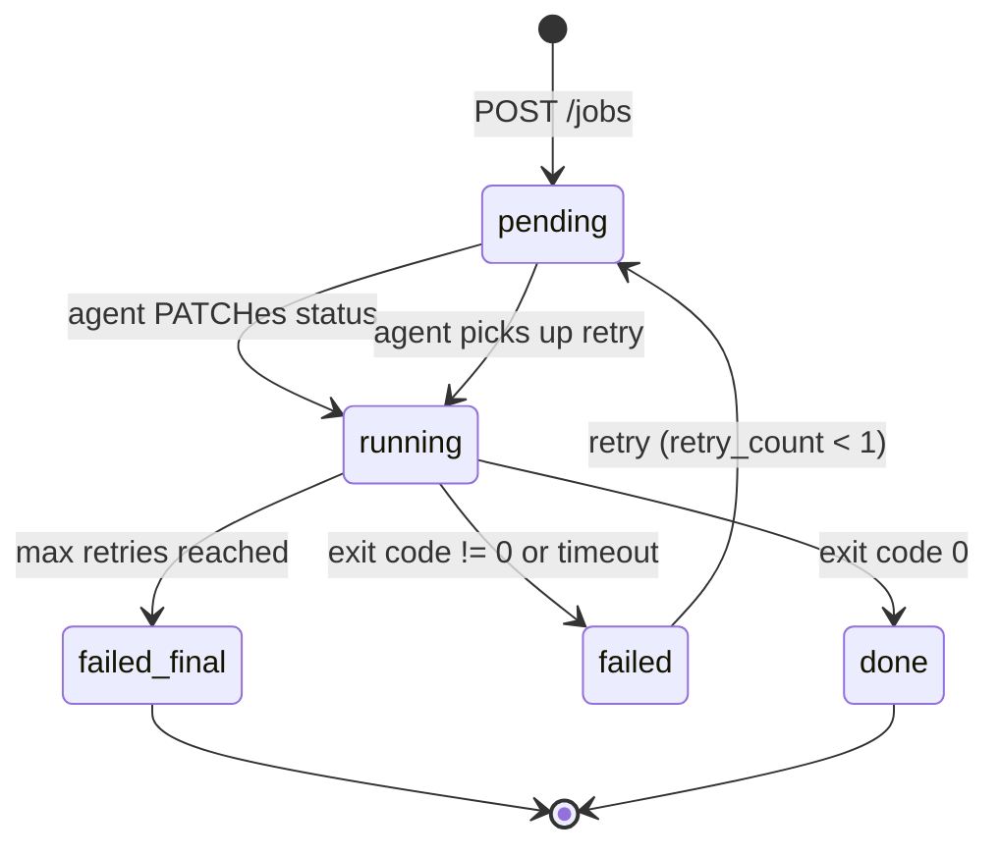

The registry knows what exists. The agent runs things. Between them sits the scheduler -- it decides which machine runs which job. It lives in `control-plane/scheduler/main.go`. One Go binary, one HTTP server on port 9001, a SQLite store, and a handful of goroutines.

---

## The Job struct

```go
type Job struct {
    ID         string            `json:"job_id"`
    NodeID     string            `json:"node_id"`
    InstanceID string            `json:"instance_id,omitempty"`
    Command    string            `json:"command"`
    DeployURL  string            `json:"deploy_url,omitempty"`
    JobType    string            `json:"job_type,omitempty"`
    Port       int               `json:"port,omitempty"`
    EnvVars    map[string]string `json:"env_vars,omitempty"`
    Status     string            `json:"status"`
    RetryCount int               `json:"retry_count"`
    ExitCode   *int              `json:"exit_code,omitempty"`
    Stdout     string            `json:"stdout,omitempty"`
    Stderr     string            `json:"stderr,omitempty"`
    CreatedAt  time.Time         `json:"created_at"`
    RunningAt  *time.Time        `json:"running_at,omitempty"`
    FinishedAt *time.Time        `json:"finished_at,omitempty"`
}
```

`JobType` is `"run"` (one-shot, default) or `"service"` (long-running). `DeployURL` points to a zip in the object store. `Port` tells the load balancer where to route traffic. `EnvVars` are key-value pairs injected into the process. `ExitCode` is a pointer -- `nil` until the job finishes.

---

## submitJob: placing work

```go
func submitJob(w http.ResponseWriter, r *http.Request, registryURL string) {
    var req JobRequest
    if err := json.NewDecoder(r.Body).Decode(&req); err != nil {
        http.Error(w, "failed to decode job", http.StatusBadRequest)
        return
    }
    if req.Command == "" && req.DeployURL == "" {
        http.Error(w, "command or deploy_url is required", http.StatusBadRequest)
        return
    }

    var node *Node
    if req.InstanceID != "" {
        node, _ = pickNodeForInstance(registryURL, req.InstanceID)
    } else {
        node, _ = pickHealthyComputeNode(registryURL)
    }

    seq := atomic.AddUint64(&jobSeq, 1)
    job := Job{
        ID: fmt.Sprintf("job-%d", seq), NodeID: node.ID,
        Command: req.Command, DeployURL: req.DeployURL,
        JobType: req.JobType, Port: req.Port, EnvVars: req.EnvVars,
        Status: "pending", CreatedAt: time.Now().UTC(),
    }

    jobsMu.Lock()
    jobs[job.ID] = job
    jobStore.Save(job)
    jobsMu.Unlock()

    w.WriteHeader(http.StatusCreated)
    json.NewEncoder(w).Encode(job)
}
```

Decode, pick a node, create a pending job, persist, return 201. Job IDs are monotonic (`job-1`, `job-2`, ...).

---

## pickHealthyComputeNode: round-robin

```go
var counter uint64

func pickHealthyComputeNode(registryURL string) (*Node, error) {
    nodes, _ := fetchComputeNodes(registryURL)

    healthy := make([]Node, 0)
    for _, node := range nodes {
        if node.Status == "healthy" { healthy = append(healthy, node) }
    }
    if len(healthy) == 0 {
        return nil, fmt.Errorf("no healthy compute nodes")
    }

    idx := atomic.AddUint64(&counter, 1) % uint64(len(healthy))
    return &healthy[idx], nil
}
```

Fetch compute nodes from the registry, filter to healthy, pick the next one with an atomic counter. No bin-packing, no memory-aware scheduling. Round-robin. When a job targets a specific instance, `pickNodeForInstance` looks it up and routes to that node.

---

## The agent polls for work

Every 3 seconds, the agent calls `GET /jobs?node_id=X&status=pending`. The scheduler checks concurrency before returning results:

```go
if nodeID != "" && status == "pending" {
    maxJobs := maxJobsPerNode()
    running := 0
    for _, job := range jobs {
        if job.NodeID == nodeID && job.Status == "running" { running++ }
    }
    if running >= maxJobs {
        json.NewEncoder(w).Encode([]Job{})
        return
    }
}
```

`MAX_JOBS_PER_NODE` defaults to 1. If a node already has a running job, the scheduler returns an empty list. The agent sleeps 3 seconds and tries again.

---

## Job lifecycle



---

## updateJob: status transitions and retry

```go
func updateJob(w http.ResponseWriter, r *http.Request, id string) {
    var req JobUpdateRequest
    json.NewDecoder(r.Body).Decode(&req)

    allowed := map[string]bool{"running": true, "done": true, "failed": true}
    if !allowed[req.Status] {
        http.Error(w, "invalid status", http.StatusBadRequest)
        return
    }

    jobsMu.Lock()
    job, ok := jobs[id]
    // ...

    if req.Status == "failed" && job.RetryCount < maxJobRetries {
        job.RetryCount++
        job.Status = "pending"
        job.ExitCode = nil
        job.Stdout = ""
        job.FinishedAt = nil
        jobs[job.ID] = job
        jobStore.Save(job)
        jobsMu.Unlock()
        return
    }

    job.Status = req.Status
    if req.Status == "running" { now := time.Now().UTC(); job.RunningAt = &now }
    if req.Status == "done" || req.Status == "failed" {
        now := time.Now().UTC(); job.FinishedAt = &now
    }
    jobs[job.ID] = job
    jobStore.Save(job)
    jobsMu.Unlock()
```

`maxJobRetries` is 1. First failure resets to `pending`. Second failure stays `failed`. On `done` or `failed` (final), the scheduler publishes to SNS if `SNS_URL` is set:

```go
if snsURL := os.Getenv("SNS_URL"); snsURL != "" {
    go snsPublish(snsURL, "job-status",
        fmt.Sprintf(`{"job_id":"%s","status":"%s"}`, id, req.Status))
}
```

---

## watchJobTimeouts: the safety net

A goroutine runs every 10 seconds, scanning for running jobs that exceed `JOB_TIMEOUT_SECS` (default 3600). It measures from `RunningAt` (falling back to `CreatedAt`) and marks stale jobs `failed` with exit code -1 and stderr `"job timed out"`. Catches crashed agents, network partitions, and runaway processes.

---

## SQS integration

When `SQS_URL` is set, a goroutine polls the `jobs` queue every 5 seconds:

```go
func pollSQSQueue(sqsURL, registryURL string) {
    ticker := time.NewTicker(5 * time.Second)
    for range ticker.C {
        resp, err := http.Get(sqsURL + "/queues/jobs/messages")
        // decode message body as JobRequest, pick node, create job
        // ack: DELETE /queues/jobs/messages/{id}
    }
}
```

The message body is a `JobRequest` JSON, identical to `POST /jobs`. If node selection fails, the message is not deleted and will be redelivered.

---

## Job types: "run" vs "service"

| | `run` | `service` |
|---|---|---|
| Execution | Agent blocks until exit | Agent spawns detached |
| Registry | No service record | `POST /services` |
| Load balancer | Not discoverable | Discovered via `/services` |
| Timeout | `JOB_TIMEOUT_SECS` (1 hour) | No scheduler timeout |
| Cgroup defaults | 512 MB / 100% CPU | 1024 MB / 200% CPU |

Both flow through the same `submitJob` and `updateJob` paths. The agent differentiates at execution time.

---

The scheduler picks the next healthy machine and hands it work. For a handful of nodes, that is enough.
