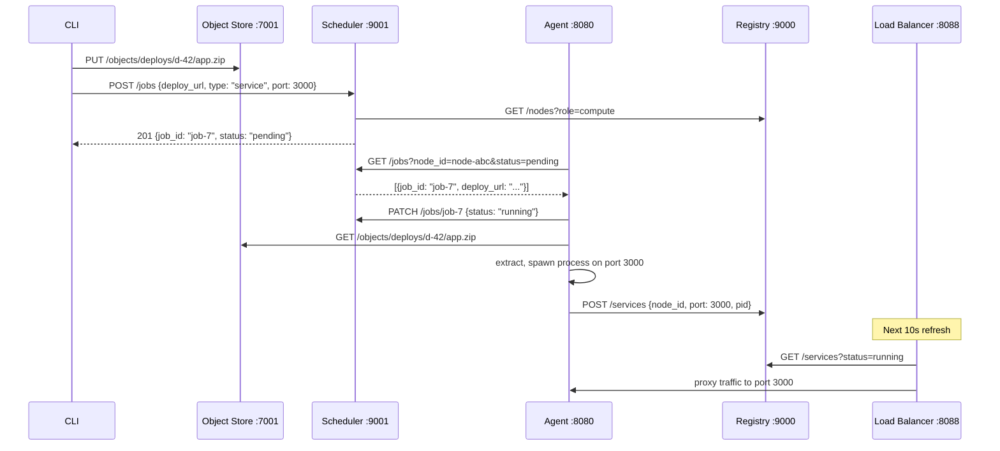

You type `tinyaws deploy`. Your application is zipped, uploaded, scheduled, downloaded, extracted, started, registered, and serving traffic. Here is every step.

---

## Step 1: CLI zips and uploads

The CLI compresses your project directory and uploads it to the object store (`PUT /objects/deploys/{id}/app.zip`), then submits a job:

```
POST /jobs
{
    "deploy_url": "http://10.0.0.1:7001/objects/deploys/d-42/app.zip",
    "job_type": "service",
    "port": 3000,
    "command": "node server.js",
    "env_vars": {"NODE_ENV": "production"}
}
```

The scheduler picks a healthy compute node (round-robin), creates a pending job, and returns 201.

---

## Step 2: Agent picks up the job

The agent polls every 3 seconds (`GET /jobs?node_id=X&status=pending`), takes the first pending job, and marks it `running`. For service jobs, work is spawned into a background task so the poll loop continues:

```rust
if job.job_type == "service" {
    tokio::spawn(async move {
        run_service(client2, scheduler_url2, registry_url2,
                    node_id2, job2, ws, pids2).await;
    });
    continue;
}
```

---

## Step 3: Download and extract

```rust
async fn download_and_extract(
    client: &reqwest::Client, deploy_url: &str, dir: &PathBuf,
) -> Result<(), String> {
    let bytes = client.get(deploy_url).send().await?.bytes().await?;
    std::fs::create_dir_all(dir)?;
    std::fs::write(dir.join("app.zip"), &bytes)?;

    let extract_cmd = format!("unzip -o '{}' -d '{}'",
        dir.join("app.zip").display(), dir.display());
    let (code, _, err) = run_command_in(&extract_cmd, None, None, &HashMap::new()).await;
    if code != 0 { return Err(format!("extract failed: {}", err)); }
    Ok(())
}
```

Download the zip, write it, shell out to `unzip`. If extraction fails, the job is reported as `failed`.

---

## Step 4: Check for tinyaws.build

If the deploy directory contains a `tinyaws.build` file, the agent builds a rootfs image before starting:

```
base: ubuntu
packages: python3 python3-pip
run: pip install -r requirements.txt
start: python3 app.py
```

`builder.rs` parses this, copies the base rootfs, runs `apt-get install` in a chroot, executes build commands, and caches the result by content hash at `/var/lib/tinyaws/images/{hash}/`. Deploy the same build spec twice and the second deploy skips the build entirely.

```rust
#[cfg(unix)]
let (rootfs_image, overlay_scratch) = if let Some(ref spec) = build_spec {
    match crate::builder::build_image(spec) {
        Ok(img) => {
            let scratch = crate::sandbox::prepare_overlay(&job.job_id);
            (Some(img), Some(scratch))
        }
        Err(e) => { /* report failed, return */ }
    }
} else { (None, None) };
```

Without `tinyaws.build`, the agent runs the command directly with namespace isolation only.

---

## Step 5: Spawn the process

Services use `std::process::Command::spawn` -- detached, non-blocking:

```rust
let mut cmd = std::process::Command::new(&prog);
cmd.args(&args)
    .current_dir(&run_dir)
    .stdout(log_file)
    .stderr(log_clone);

for (k, v) in &job.env_vars { cmd.env(k, v); }

#[cfg(unix)]
{
    use std::os::unix::process::CommandExt;
    unsafe { cmd.pre_exec(|| { libc::setpgid(0, 0); Ok(()) }); }
}

let child = cmd.spawn()?;
```

Key details: stdout/stderr go to `service.log`, not the agent's output. `env_vars` from the CLI are injected via `cmd.env()`. `setpgid(0, 0)` creates a new process group so `kill(-pgid, SIGTERM)` can kill the entire tree. On Linux with sandboxing, the command is wrapped in `unshare`; if a rootfs was built, overlayfs and `pivot_root` are added (Chapter 25).

---

## Step 6: Register with the registry

Immediately after spawning:

```rust
let payload = serde_json::json!({
    "node_id": node_id,
    "instance_id": job.instance_id,
    "port": job.port,
    "pid": pid,
    "deploy_url": job.deploy_url,
});
client.post(format!("{}/services", registry_url))
    .json(&payload).send().await;
```

`POST /services` creates a service record. The load balancer discovers it on the next 10-second refresh (`GET /services?status=running`), builds a target URL from the node's address and port, and starts routing traffic.

---

## Step 7: Monitor the process

```rust
let exit_status = tokio::task::spawn_blocking(move || child.wait()).await;
let exit_code = match exit_status {
    Ok(Ok(status)) => status.code().unwrap_or(-1),
    _ => -1,
};

let final_status = if exit_code == 0 { "done" } else { "crashed" };
```

`spawn_blocking` moves the blocking `wait()` off the async runtime. On exit, the agent cleans up sandbox artifacts, updates the registry service record, and reports to the scheduler. The PID is also tracked in a shared map -- if the registry marks a service `stopped`, a kill-poller sends `SIGTERM` to the process group.

---

## Step 8: Log upload

A background task uploads `service.log` to the object store every 30 seconds:

```rust
fn start_log_upload(svc_id: String, log_path: PathBuf, done_flag: Arc<AtomicBool>) {
    tokio::spawn(async move {
        let client = reqwest::Client::new();
        let mut ticker = interval(Duration::from_secs(30));
        let url = format!("{}/objects/logs/{}/service.log", store_url, svc_id);
        loop {
            ticker.tick().await;
            if let Ok(data) = std::fs::read(&log_path) {
                client.put(&url).header("content-type", "text/plain").body(data).send().await;
            }
            if done_flag.load(Ordering::Relaxed) { break; }
        }
    });
}
```

Full file re-upload every 30 seconds. When the service exits, `done_flag` is set and the loop does one final upload. Not streaming, but sufficient for small services.

---

## The complete flow



---

## Environment variables

`--env KEY=VAL` flows through every layer:

1. CLI includes it in `POST /jobs` as `env_vars: {"KEY": "VAL"}`.
2. Scheduler stores it in the Job struct, persists to SQLite.
3. Agent calls `cmd.env(k, v)` before spawning.

Plaintext in the scheduler's SQLite and over HTTP. Acceptable for a local dev cluster.

---

## Crash handling

When a service exits unexpectedly, the monitor detects it via `child.wait()`, sets the registry status to `crashed`, and reports `failed` to the scheduler. The scheduler's retry logic (Chapter 27) can re-queue the job once. The load balancer stops routing to the dead backend on its next health check (every 10 seconds).

---

One command. No Docker, no Kubernetes, no YAML. A zip file, a job record, a spawned process, and a service registration. The load balancer finds it. Traffic flows.
