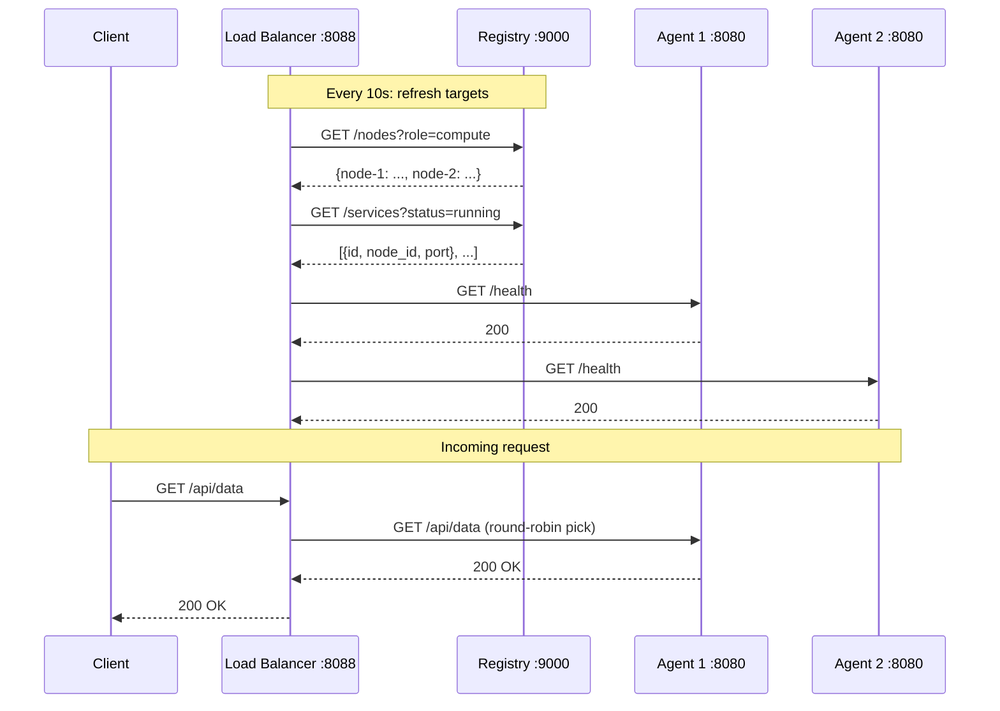

Your service is running on an agent. Maybe on one machine, maybe on three. The load balancer makes them look like one.

The whole thing lives in `data-plane/networking/load-balancer/main.go`. It is 207 lines. It polls the registry for compute nodes and running services, health-checks each one, and round-robins incoming HTTP requests to the next healthy backend.

---

## The Target struct

Every backend the LB knows about is a `Target`:

```go
type Target struct {
    URL       string `json:"url"`
    Healthy   bool   `json:"healthy"`
    ServiceID string `json:"service_id,omitempty"`
    NodeID    string `json:"node_id,omitempty"`
}
```

Two kinds of targets exist. **Agent targets** are the agent process itself on a compute node, listening on port 8080. **Service targets** are deployed applications registered by agents, each on its own port. Both sit in the same flat list. The LB does not distinguish between them when proxying -- it picks the next healthy one.

---

## syncTargets: discovering backends

A goroutine calls `refresh()` every 10 seconds:

```go
func syncTargets() {
    ticker := time.NewTicker(10 * time.Second)
    defer ticker.Stop()

    for {
        refresh()
        <-ticker.C
    }
}
```

`refresh()` does two things. First, it calls `GET /nodes?role=compute` on the registry to get compute nodes. For each healthy node, it builds an agent URL, preferring `Addr` (set via `AGENT_ADVERTISE_ADDR`) over `Hostname` -- this matters for multi-machine clusters where the hostname may not resolve from the LB's network:

```go
host := node.Addr
if host == "" {
    host = node.Hostname
}
agentURL := fmt.Sprintf("http://%s:8080", host)
```

Second, it calls `GET /services?status=running` and maps each service's `NodeID` back to a hostname, constructing a URL from the service's port:

```go
svcURL := fmt.Sprintf("http://%s:%d", host, svc.Port)
```

Services with port 0 or an unknown NodeID are skipped. After building the full list, the function swaps it in under a mutex.

---

## Health checking

Each target gets a health check during refresh:

```go
func checkHealth(agentURL string) bool {
    resp, err := http.Get(agentURL + "/health")
    if err != nil {
        return false
    }
    resp.Body.Close()
    return resp.StatusCode == http.StatusOK
}
```

`GET /health` on the backend. 200 means healthy. Anything else -- connection refused, timeout, 500 -- means unhealthy.

---

## Round-robin selection

```go
func nextTarget() *Target {
    targetsMu.RLock()
    defer targetsMu.RUnlock()

    healthy := []Target{}
    for _, t := range targets {
        if t.Healthy {
            healthy = append(healthy, t)
        }
    }
    if len(healthy) == 0 {
        return nil
    }
    idx := atomic.AddUint64(&counter, 1) % uint64(len(healthy))
    t := healthy[idx]
    return &t
}
```

Filter to healthy targets. Atomically increment a counter. Modulo by the count. The atomic counter means concurrent requests spread across backends without locking beyond the read lock on the target list.

---

## The reverse proxy

The catch-all handler uses `httputil.NewSingleHostReverseProxy`:

```go
http.HandleFunc("/", func(w http.ResponseWriter, r *http.Request) {
    t := nextTarget()
    if t == nil {
        http.Error(w, "no healthy backends", http.StatusServiceUnavailable)
        return
    }
    u, _ := url.Parse(t.URL)
    proxy := httputil.NewSingleHostReverseProxy(u)
    proxy.ErrorHandler = func(w http.ResponseWriter, r *http.Request, err error) {
        log.Printf("lb: proxy error to %s: %v", t.URL, err)
        http.Error(w, "backend error", http.StatusBadGateway)
    }
    proxy.ServeHTTP(w, r)
})
```

No target returns 503. A new proxy is created per request -- simple but not free. For a local cluster, the allocation cost does not matter.

---

## Request flow



---

## Diagnostic endpoints

`GET /targets` returns the full target list as JSON, including health status -- useful for debugging which backends are known and which are healthy.

`GET /health` reports the LB's own status and how many targets it tracks:

```go
fmt.Fprintf(w, `{"status":"healthy","service":"lb","targets":%d}`, n)
```

---

No SSL termination, no sticky sessions, no weighted routing. Round-robin to the next healthy backend. For a local cluster, that's all you need.
