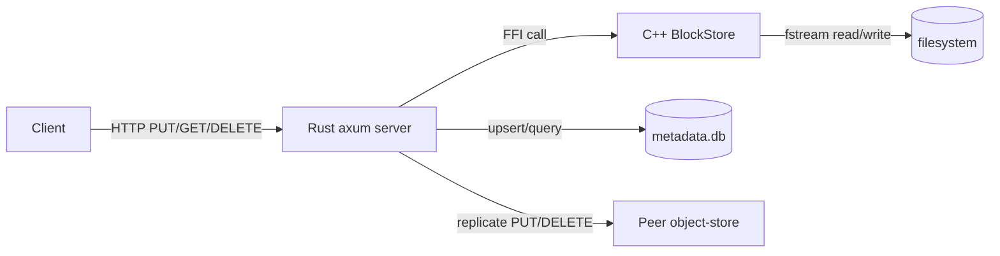
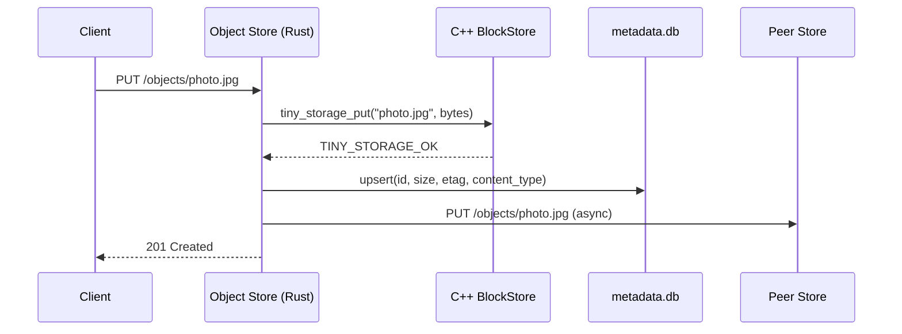

Every cloud needs storage. AWS has S3 -- millions of servers, exabytes of data. tiny-aws has a C++ file engine, a Rust HTTP layer, and one disk.

The object store spans two directories: `data-plane/storage/engine/` (C++) and `data-plane/storage/object-store/` (Rust). The C++ code does raw file I/O. The Rust code wraps it via FFI and serves HTTP with axum.

---

## Architecture



Client sends HTTP to the Rust server. The server calls into C++ through an FFI boundary. C++ reads or writes a file on disk. Metadata (size, etag, content-type) lives in SQLite on the Rust side.

---

## Why two languages?

The C++ engine gives direct control over filesystem operations -- `std::fstream`, `std::filesystem::create_directories`, explicit buffer management. The Rust layer provides async HTTP via axum and tokio, type-safe request handling, and safe concurrency. The split is educational: it demonstrates FFI across a language boundary and how storage systems often have a low-level engine behind a higher-level API server.

---

## The C++ engine

The C header (`engine/include/tiny_storage.h`) defines the contract between Rust and C++:

```c
typedef struct TinyStorage TinyStorage;

typedef enum {
    TINY_STORAGE_OK        =  0,
    TINY_STORAGE_ERR       = -1,
    TINY_STORAGE_NOT_FOUND = -2,
} TinyStorageStatus;

TinyStorage*      tiny_storage_open(const char* root_path);
void              tiny_storage_close(TinyStorage* store);
TinyStorageStatus tiny_storage_put(TinyStorage* store, const char* id,
                                   const uint8_t* data, size_t len);
TinyStorageStatus tiny_storage_get(TinyStorage* store, const char* id,
                                   uint8_t** out_data, size_t* out_len);
TinyStorageStatus tiny_storage_delete(TinyStorage* store, const char* id);
void              tiny_storage_free_buffer(uint8_t* data);
```

`TinyStorage` is an opaque handle. Rust never sees inside it. The `BlockStore` class in `block_store.cpp` maps object IDs directly to filesystem paths. `put` writes bytes via `std::ofstream`. `get` reads the entire file into memory. `remove` deletes it. Parent directories are created on write so keys like `my-bucket/photo.jpg` work without pre-creating directories.

The FFI layer (`ffi.cpp`) wraps the C++ class in C functions, catching all exceptions and converting them to status codes. The caller frees read buffers with `tiny_storage_free_buffer`, which calls `std::free`.

---

## The Rust side

Rust declares matching C functions in `ffi.rs` and wraps them in a safe `BlockStore` struct (`store.rs`):

```rust
pub struct BlockStore {
    handle: *mut TinyStorage,
}

impl BlockStore {
    pub fn write_block(&self, block: &Block) -> std::io::Result<()> {
        let c_id = CString::new(block.id.as_str())?;
        let status = unsafe {
            ffi::tiny_storage_put(self.handle, c_id.as_ptr(),
                                  block.data.as_ptr(), block.data.len())
        };
        match status {
            TINY_STORAGE_OK => Ok(()),
            _ => Err(/* ... */),
        }
    }
}

impl Drop for BlockStore {
    fn drop(&mut self) {
        unsafe { ffi::tiny_storage_close(self.handle) };
    }
}

unsafe impl Send for BlockStore {}
unsafe impl Sync for BlockStore {}
```

`Drop` ensures the C++ engine is closed when the Rust struct is dropped. `Send + Sync` are manually implemented because the raw pointer is not automatically thread-safe.

---

## HTTP endpoints

The axum server exposes PUT/GET/DELETE on `/objects/{id}`, bucket operations on `/buckets/{bucket}/objects/{key}`, and listing endpoints. On every PUT, the server computes a SHA-256 hash for the etag, records size and content-type, and upserts the metadata row in SQLite.

All data endpoints pass through a bearer auth middleware. If `TINYAWS_API_KEY` is set, every request must include `Authorization: Bearer <key>`. If the env var is empty, auth is skipped.

---

## SQLite metadata

```sql
CREATE TABLE objects (
    id            TEXT PRIMARY KEY,
    size          INTEGER NOT NULL,
    content_type  TEXT NOT NULL DEFAULT 'application/octet-stream',
    etag          TEXT NOT NULL DEFAULT '',
    created_at    TEXT NOT NULL DEFAULT (datetime('now')),
    updated_at    TEXT NOT NULL DEFAULT (datetime('now'))
);
```

Bytes go to the C++ engine. Metadata goes to SQLite. This separation means you can list and query objects without reading the files.

---

## Registration and replication

On startup, the object store registers as a `storage` node with the registry and sends heartbeats every 10 seconds. A background task polls the registry every 15 seconds for other storage nodes, filtering out itself and unhealthy peers.

On PUT, after the local write succeeds, the server fans out to `REPLICATION_FACTOR - 1` peers. Default factor is 1 (no replication). On GET, if the local engine returns not-found, the server tries each peer before returning 404.



On every successful PUT, the object store also fires an SNS event to the `s3:ObjectCreated` topic if `SNS_URL` is configured. This is how it triggers Lambda functions.

---

One copy on one disk. If the disk fails, the data is gone. That's the honest tradeoff.
