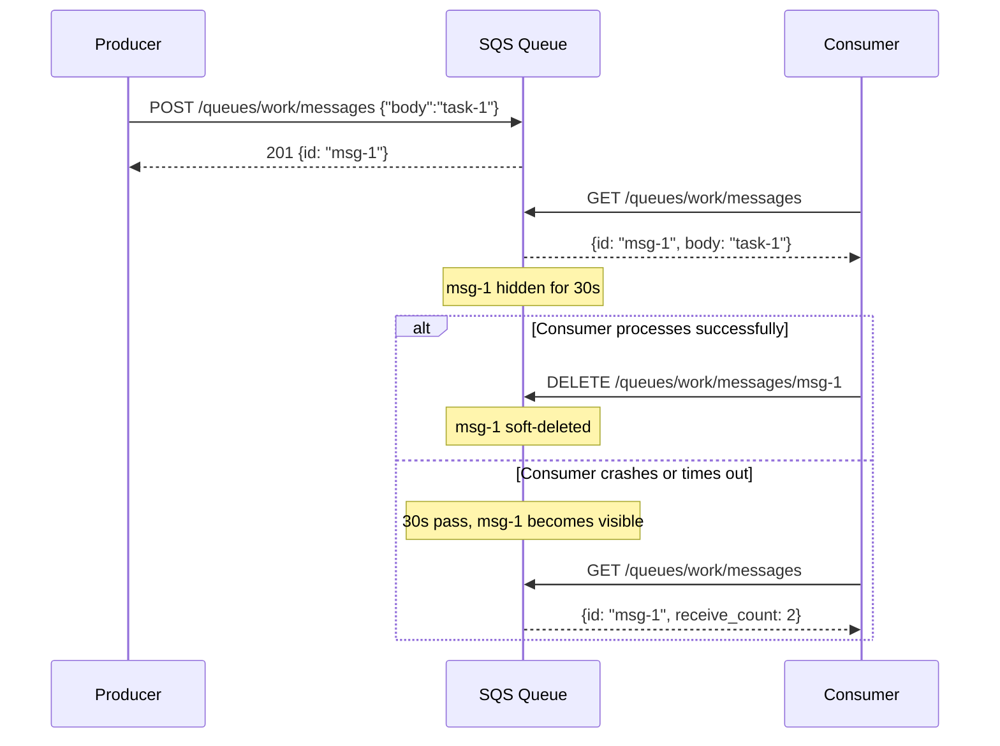

A queue is the simplest useful distributed system primitive. Producer puts a message in. Consumer takes it out.

The implementation lives in `control-plane/messaging/sqs/main.go`. It is 252 lines, backed by SQLite, and supports the core SQS pattern: send, receive with visibility timeout, delete to acknowledge, and dead letter queues for poison messages.

---

## The schema

Two tables:

```sql
CREATE TABLE queues (
    name              TEXT PRIMARY KEY,
    created_at        TEXT NOT NULL,
    dead_letter_queue TEXT NOT NULL DEFAULT '',
    max_receive_count INTEGER NOT NULL DEFAULT 5
);

CREATE TABLE messages (
    id            TEXT PRIMARY KEY,
    queue_name    TEXT NOT NULL,
    body          TEXT NOT NULL,
    visible_after TEXT NOT NULL,
    deleted       INTEGER NOT NULL DEFAULT 0,
    receive_count INTEGER NOT NULL DEFAULT 0
);
```

Queues are named. Messages belong to a queue. Each message tracks how many times it has been received and when it becomes visible again. `deleted` is a soft-delete flag -- acknowledged messages stay in the database but are never returned.

---

## Queue CRUD

`POST /queues/{name}` creates a queue. The body is optional -- if provided, you can configure a `dead_letter_queue` name and `max_receive_count` (default 5). `ON CONFLICT DO NOTHING` makes creation idempotent. `GET /queues` returns an array of queue names.

---

## Send: POST /queues/{name}/messages

```go
seq := atomic.AddUint64(&msgSeq, 1)
id := fmt.Sprintf("msg-%d", seq)
_, err := db.Exec(
    `INSERT INTO messages (id, queue_name, body, visible_after) VALUES (?, ?, ?, ?)`,
    id, name, req.Body, time.Now().UTC().Format(time.RFC3339),
)
```

Message IDs are sequential: `msg-1`, `msg-2`, `msg-3`. The counter is an atomic uint64, initialized from the highest existing ID on startup so IDs survive restarts. `visible_after` is set to now, meaning the message is immediately visible.

---

## Receive: GET /queues/{name}/messages

The query finds the oldest non-deleted message whose `visible_after` is in the past:

```go
row := db.QueryRow(
    `SELECT id, body, receive_count FROM messages
     WHERE queue_name = ? AND deleted = 0 AND visible_after <= ?
     ORDER BY rowid LIMIT 1`,
    name, now.Format(time.RFC3339),
)
```

When a message is received, it becomes invisible for 30 seconds:

```go
receiveCount++
visibleAfter := now.Add(30 * time.Second)
db.Exec(`UPDATE messages SET visible_after = ?, receive_count = ? WHERE id = ?`,
    visibleAfter.Format(time.RFC3339), receiveCount, id)
```

If the consumer processes it and calls DELETE within 30 seconds, the message is gone. If not, it becomes visible again for another consumer.

Before returning the message, the handler checks the DLQ policy. If `receiveCount` exceeds `max_receive_count` and a dead letter queue is configured, the message is moved there:

```go
if dlqName != "" && maxReceives > 0 && receiveCount > maxReceives {
    db.Exec(`UPDATE messages SET queue_name = ?, receive_count = ?, visible_after = ? WHERE id = ?`,
        dlqName, receiveCount, now.Format(time.RFC3339), id)
    // return null -- message moved to DLQ
    return
}
```

The consumer sees nothing -- the message disappears from the source queue and reappears in the DLQ.

---

## Delete (Ack): DELETE /queues/{name}/messages/{id}

```go
db.Exec(`UPDATE messages SET deleted = 1 WHERE id = ?`, id)
w.WriteHeader(http.StatusNoContent)
```

Soft delete. The message stays in the database but will never be returned by a receive call.

---

## The message lifecycle



---

## Internal wiring: the scheduler polls the jobs queue

When `SQS_URL` is set, the scheduler polls the `jobs` queue every 5 seconds:

```go
func pollSQSQueue(sqsURL, registryURL string) {
    ticker := time.NewTicker(5 * time.Second)
    defer ticker.Stop()

    for range ticker.C {
        resp, err := http.Get(sqsURL + "/queues/jobs/messages")
        // decode message, parse body as JobRequest
        // pick a healthy compute node
        // create a Job and persist it
        // ack the message:
        delReq, _ := http.NewRequest(http.MethodDelete,
            fmt.Sprintf("%s/queues/jobs/messages/%s", sqsURL, msg.ID), nil)
        http.DefaultClient.Do(delReq)
    }
}
```

External systems submit work by dropping a message on the `jobs` queue instead of calling the scheduler API directly. The scheduler picks it up, creates a job, and acks the message. Same pattern AWS uses: services submit work to SQS, workers pull from the queue.

---

No FIFO, no exactly-once. But produce, consume, ack, retry -- that's real. DLQ prevents poison messages.
