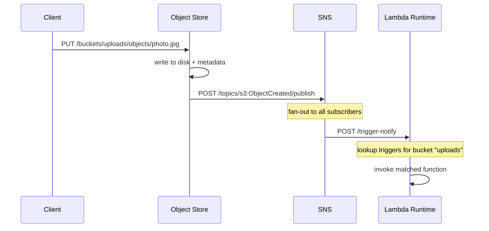

SQS is point-to-point. SNS is fan-out: one event, many subscribers.

The implementation lives in `control-plane/messaging/sns/main.go`. It is 175 lines. Topics hold subscriptions. Publishing to a topic fires an HTTP POST to every subscriber endpoint. No retry, no persistence of published messages, no delivery guarantee beyond "we tried."

---

## The schema

Two SQLite tables:

```sql
CREATE TABLE topics (
    name       TEXT PRIMARY KEY,
    created_at TEXT NOT NULL
);

CREATE TABLE subscriptions (
    id       TEXT PRIMARY KEY,
    topic    TEXT NOT NULL,
    endpoint TEXT NOT NULL
);
```

Topics are named strings. Subscriptions bind an HTTP endpoint to a topic.

---

## Topics and subscriptions

`POST /topics/{name}` creates a topic. `ON CONFLICT DO NOTHING` makes it idempotent.

`POST /topics/{name}/subscribe` registers an HTTP endpoint:

```go
func handleSubscribe(w http.ResponseWriter, r *http.Request) {
    topic := r.PathValue("name")
    var req struct {
        Endpoint string `json:"endpoint"`
    }
    if err := json.NewDecoder(r.Body).Decode(&req); err != nil || req.Endpoint == "" {
        http.Error(w, "endpoint required", http.StatusBadRequest)
        return
    }
    seq := atomic.AddUint64(&subSeq, 1)
    id := fmt.Sprintf("sub-%d", seq)
    db.Exec(`INSERT INTO subscriptions (id, topic, endpoint) VALUES (?, ?, ?)`,
        id, topic, req.Endpoint)
    w.WriteHeader(http.StatusCreated)
    json.NewEncoder(w).Encode(map[string]string{"id": id})
}
```

No confirmation handshake. In real AWS SNS, subscribing an HTTP endpoint triggers a confirmation request. Here, you subscribe and you are immediately active.

---

## Publish: POST /topics/{name}/publish

The core of SNS -- the fan-out:

```go
rows, err := db.Query(`SELECT endpoint FROM subscriptions WHERE topic = ?`, topic)
// ...
var endpoints []string
for rows.Next() {
    var ep string
    if err := rows.Scan(&ep); err == nil {
        endpoints = append(endpoints, ep)
    }
}

payload, _ := json.Marshal(map[string]string{"topic": topic, "message": req.Message})
for _, ep := range endpoints {
    go func(ep string) {
        if _, err := http.Post(ep, "application/json", bytes.NewReader(payload)); err != nil {
            log.Printf("sns: delivery to %s failed: %v", ep, err)
        }
    }(ep)
}
```

Each delivery is a separate goroutine. They run concurrently. If one endpoint is slow, it does not block the others. If one fails, the error is logged and the message is lost for that subscriber. The response returns before any delivery completes.

---

## How tiny-aws uses SNS internally

SNS is the event bus that connects services. Three producers publish events:

**Registry: instance-launch.** When a new instance is created via `POST /instances`, the registry fires an event with the instance and node IDs.

**Scheduler: job-status.** When a job transitions to `done` or `failed`:

```go
if req.Status == "done" || req.Status == "failed" {
    if snsURL := os.Getenv("SNS_URL"); snsURL != "" {
        go snsPublish(snsURL, "job-status",
            fmt.Sprintf(`{"job_id":"%s","status":"%s"}`, id, req.Status))
    }
}
```

**Object store: s3:ObjectCreated.** When an object is written via PUT, the Rust server publishes to the `s3:ObjectCreated` topic with the bucket, key, and size.

**Lambda subscribes.** On startup, the Lambda runtime creates the `s3:ObjectCreated` topic (idempotent) and subscribes its `/trigger-notify` endpoint:

```go
http.Post(snsURL+"/topics/s3:ObjectCreated", "application/json", nil)

endpoint := lambdaAddr + "/trigger-notify"
http.Post(snsURL+"/topics/s3:ObjectCreated/subscribe",
    "application/json",
    /* {"endpoint": "http://lambda:9007/trigger-notify"} */)
```

When an object is uploaded, the chain is: object store PUT, SNS publish, Lambda `/trigger-notify`, trigger lookup, function invocation.

---

## The event chain



This is the same wiring AWS uses. S3 events trigger Lambda functions via SNS. The difference is scale and reliability.

---

## The helper function

Both the registry and scheduler use the same `snsPublish` helper (defined locally in each service):

```go
func snsPublish(snsURL, topic, message string) {
    payload := fmt.Sprintf(`{"message":%q}`, message)
    resp, err := http.Post(
        fmt.Sprintf("%s/topics/%s/publish", snsURL, topic),
        "application/json",
        bytes.NewBufferString(payload),
    )
    if err != nil {
        log.Printf("sns publish error: %v", err)
        return
    }
    resp.Body.Close()
}
```

Best-effort. If SNS is down, the error is logged and the event is lost. The caller never fails because of a notification failure.

---

No retry, HTTP only. But the wiring -- S3 triggers Lambda via SNS -- is exactly how AWS does it, minus the reliability.
