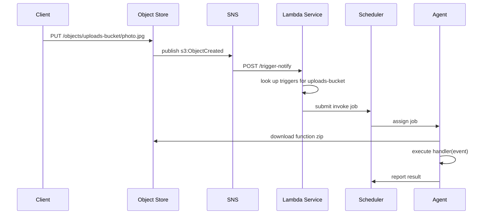

## The idea

You have a function. You want to run it. You do not want to think about servers,
containers, agents, or capacity. Just say "run this code with this input" and
get a result back.

AWS Lambda is built on microVMs, warm pools, and a sophisticated placement
system. tiny-aws Lambda is built on the scheduler and the object store. Upload
your code as a zip. Invoke by name. The scheduler runs it on whatever agent is
available. Every invocation is cold.

## The function model

```go
type Function struct {
    Name    string `json:"name"`
    Runtime string `json:"runtime"` // "python3" or "node20"
    Handler string `json:"handler"` // "module.function_name"
    Bucket  string `json:"bucket"`  // object store bucket
    Key     string `json:"key"`     // object store key (the zip)
}
```

`Runtime` selects the bootstrap logic at invoke time. `Handler` follows the
`module.function` convention. `Bucket` and `Key` point to the zip in the object
store. No versioning, no aliases, no layers.

## Creating a function

```
POST /functions
{
    "name": "resize-image",
    "runtime": "python3",
    "handler": "resize.handle",
    "bucket": "code-bucket",
    "key": "resize-v1.zip"
}
```

The handler validates fields, inserts a row into the `functions` table, and
returns 201. It does not download the zip or validate the handler. Creation is
a metadata operation. Failure happens at invoke time.

## Invoking a function

`POST /functions/{name}/invoke` with a JSON body (the event). `handleInvoke`:

1. Look up the function by name in SQLite.
2. Build a download URL: `http://{objectStoreURL}/objects/{bucket}/{key}`
3. Build the invoke command for the function's runtime.
4. Submit a job to the scheduler, passing parameters as **environment variables**.
5. Poll the scheduler for the result -- 60 seconds max, 2-second intervals.

The critical detail is step 4. Handler, code URL, and event are passed as
environment variables, not interpolated into a shell string:

```go
env := map[string]string{
    "TINYAWS_CODE_URL": downloadURL,
    "TINYAWS_HANDLER":  fn.Handler,
    "TINYAWS_EVENT":    string(eventBytes),
}
```

Shell interpolation of user-supplied event data would be an injection
vulnerability. Environment variables avoid that entirely.

## The invoke command

For `python3`, `buildInvokeCommand` generates a self-contained script:

```python
import os, json, zipfile, importlib, tempfile, urllib.request

d = tempfile.mkdtemp()
urllib.request.urlretrieve(os.environ['TINYAWS_CODE_URL'], d + '/fn.zip')
zipfile.ZipFile(d + '/fn.zip').extractall(d)

import sys
sys.path.insert(0, d)

handler = os.environ['TINYAWS_HANDLER']
mod, fn = handler.rsplit('.', 1)
m = importlib.import_module(mod)
ev = json.loads(os.environ['TINYAWS_EVENT'])
r = m.__dict__[fn](ev)
print(json.dumps(r))
```

Download the zip, extract, import the module, call the handler, print JSON to
stdout. The scheduler captures stdout as the job output.

## Polling for results

```go
deadline := time.Now().Add(60 * time.Second)
for time.Now().Before(deadline) {
    job, err := getJob(schedulerURL, jobID)
    if err == nil && job.Status == "completed" {
        w.Write([]byte(job.Output))
        return
    }
    if err == nil && job.Status == "failed" {
        http.Error(w, "function execution failed: "+job.Output, 500)
        return
    }
    time.Sleep(2 * time.Second)
}
http.Error(w, "function timed out", 504)
```

Sixty seconds, then timeout. No async invocation, no DLQ, no retry.

## Triggers

tiny-aws supports one trigger type: S3 object creation.

```
POST /triggers
{ "function_name": "resize-image", "event_source": "s3:ObjectCreated", "source_name": "uploads-bucket" }
```

On startup, the Lambda service calls `subscribeToS3Events`, subscribing its
`/trigger-notify` endpoint to the S3 events SNS topic:

```go
func subscribeToS3Events(snsURL, selfURL string) error {
    sub := map[string]string{"topic": "s3-events", "endpoint": selfURL + "/trigger-notify"}
    body, _ := json.Marshal(sub)
    _, err := http.Post(snsURL+"/subscriptions", "application/json", bytes.NewReader(body))
    return err
}
```

`handleTriggerNotify` receives the SNS message, looks up matching triggers, and
invokes each function with the S3 event as the payload. Each invocation fires
in a goroutine. If the function fails, the event is lost.

## The full event flow



## What is missing

Everything that makes real Lambda fast and safe: warm pools, Firecracker
sandboxing, concurrency limits, layers, async invocation with DLQ. Every
invocation downloads and extracts the zip. The function runs as a shell command
on the agent with no isolation.

## What is present

The core pattern: upload code to object storage, register a function by name,
invoke with an event payload, wire to S3 events through triggers and SNS.
Code as data. Events as triggers. Execution as someone else's problem.

Every invocation is cold. No sandbox. But upload code, invoke by name, wire to
events -- that is the real Lambda pattern.
