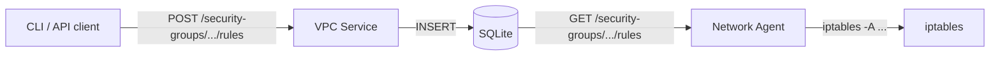

## Two systems, one goal

Networking in any cloud has two halves. The control plane stores desired state:
which CIDRs exist, which routes connect them, which ports are open. The data
plane enforces that state on real machines.

In tiny-aws, the control plane is a Go HTTP service backed by SQLite. The data
plane is a Rust agent that polls for security group rules and translates them
into iptables commands.

## The control plane: VPC service

`control-plane/networking/vpc/main.go` is 339 lines. Five resource types, five
SQLite tables.

### Data model

```go
type VPC struct {
    ID        string `json:"id"`
    Name      string `json:"name"`
    CIDRBlock string `json:"cidr_block"`
}

type Subnet struct {
    ID        string `json:"id"`
    VPCID     string `json:"vpc_id"`
    Name      string `json:"name"`
    CIDRBlock string `json:"cidr_block"`
    AZ        string `json:"availability_zone"`
}

type RouteTable struct {
    ID       string `json:"id"`
    SubnetID string `json:"subnet_id"`
    DestCIDR string `json:"dest_cidr"`
    Target   string `json:"target"`
}

type SecurityGroup struct {
    ID    string `json:"id"`
    VPCID string `json:"vpc_id"`
    Name  string `json:"name"`
}

type SGRule struct {
    ID              string `json:"id"`
    SecurityGroupID string `json:"security_group_id"`
    Direction       string `json:"direction"` // "inbound" or "outbound"
    Protocol        string `json:"protocol"`  // "tcp", "udp", "icmp"
    Port            int    `json:"port"`
    CIDRBlock       string `json:"cidr_block"`
    Action          string `json:"action"`    // "allow" or "deny"
}
```

### How they fit together

```
VPC (10.0.0.0/16)
 +-- Subnet (10.0.1.0/24)
 |    +-- Route table (0.0.0.0/0 -> igw)
 |    +-- Security group "web-sg"
 |    |    +-- rule: inbound allow tcp 80
 |    +-- Instance i-abc123
 +-- Subnet (10.0.2.0/24)
      +-- Security group "db-sg"
           +-- rule: inbound allow tcp 5432 from 10.0.1.0/24
```

### Endpoints

| Method | Path | Action |
|--------|------|--------|
| POST/GET | /vpcs | Create / list VPCs |
| POST/GET | /subnets | Create / list subnets |
| POST/GET | /route-tables | Create / list routes |
| POST/GET | /security-groups | Create / list SGs |
| POST/GET | /security-groups/{id}/rules | Add / list SG rules |
| PUT | /instances/{id}/subnet | Assign instance to subnet |

Every endpoint follows the same pattern: parse JSON, validate, insert into
SQLite, return the created resource with a generated UUID.

## The data plane: network agent

The network agent is a Rust binary that runs on each host and translates
security group rules into iptables commands.

### Poll loop

Every 30 seconds, the agent fetches rules for its security groups:

```rust
loop {
    let rules = fetch_rules(&api_url, &security_group_id)?;
    for rule in &rules {
        if !applied_rules.contains(&rule.id) {
            apply_rule_linux(rule)?;
            applied_rules.insert(rule.id.clone());
        }
    }
    thread::sleep(Duration::from_secs(30));
}
```

Already-applied rules are tracked in a `HashSet`. On restart, everything
reapplies from scratch.

### Translating rules to iptables

```rust
fn apply_rule_linux(rule: &SGRule) -> Result<(), Box<dyn Error>> {
    let chain = if rule.direction == "inbound" { "INPUT" } else { "OUTPUT" };
    let target = if rule.action == "allow" { "ACCEPT" } else { "DROP" };

    let args = vec![
        "-A", chain,
        "-p", &rule.protocol,
        "--dport", &rule.port.to_string(),
        "-s", &rule.cidr_block,
        "-j", target,
    ];

    Command::new("iptables").args(&args).status()?;
    Ok(())
}
```

Each rule becomes one iptables command. The agent only adds rules, never
removes them. This is an acknowledged gap.

## The architecture



## The metadata-versus-reality gap

| Concern | AWS | tiny-aws |
|---------|-----|----------|
| CIDR allocation | IPAM, ENI attachment | Strings in a database |
| Routing | VPC router, route propagation | Route table rows, unenforced |
| Security groups | Stateful flow tracking, hypervisor-level | iptables append-only |
| Network ACLs | Subnet-level stateless rules | Not implemented |
| DNS | Route 53 Resolver, VPC DNS | Not implemented |

The VPC service is a model of a network. The agent makes one slice real --
security group rules become iptables entries on the host. Everything else is
metadata that nothing acts on.

## What this teaches

The split between control plane and data plane is not optional. You need:

1. A source of truth (the VPC service and its database).
2. Agents that poll for that truth.
3. Agents that translate truth into local system state.
4. Reconciliation when agents restart or drift.

tiny-aws implements steps 1 through 3. Step 4 -- reconciliation, convergence,
drift detection -- is where production systems spend most of their complexity.

The VPC service is a model. The agent makes part of it real. The gap is where
real cloud networking is genuinely hard.
