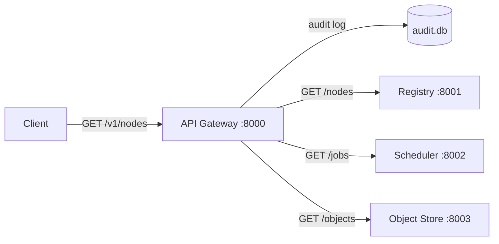

## The problem

tiny-aws runs a dozen services, each on its own port. A client should not need
to know any of this. One URL. One port. Consistent logging. The API gateway
provides that.

## The proxy function

The core of `api/main.go`:

```go
func proxy(backend string) http.Handler {
    target, _ := url.Parse(backend)
    rp := httputil.NewSingleHostReverseProxy(target)
    return http.HandlerFunc(func(w http.ResponseWriter, r *http.Request) {
        r.URL.Path = strings.TrimPrefix(r.URL.Path, "/v1")
        rp.ServeHTTP(w, r)
    })
}
```

Takes a backend URL, creates a `SingleHostReverseProxy`, returns a handler that
strips `/v1` before forwarding. `GET /v1/nodes` becomes `GET /nodes` sent to
the registry. `httputil.NewSingleHostReverseProxy` handles connection pooling,
hop-by-hop headers, and X-Forwarded-For.

## Route mapping

```go
func main() {
    registryURL   := envOr("REGISTRY_URL",   "http://localhost:8001")
    schedulerURL  := envOr("SCHEDULER_URL",  "http://localhost:8002")
    objectStoreURL := envOr("OBJECT_STORE_URL", "http://localhost:8003")
    lambdaURL     := envOr("LAMBDA_URL",     "http://localhost:8004")
    vpcURL        := envOr("VPC_URL",        "http://localhost:8005")
    snsURL        := envOr("SNS_URL",        "http://localhost:8006")
    sqsURL        := envOr("SQS_URL",        "http://localhost:8007")
    metadataURL   := envOr("METADATA_URL",   "http://localhost:8008")

    mux := http.NewServeMux()
    mux.Handle("/v1/nodes",             proxy(registryURL))
    mux.Handle("/v1/nodes/",            proxy(registryURL))
    mux.Handle("/v1/instances",         proxy(registryURL))
    mux.Handle("/v1/instances/",        proxy(registryURL))
    mux.Handle("/v1/jobs",              proxy(schedulerURL))
    mux.Handle("/v1/jobs/",             proxy(schedulerURL))
    mux.Handle("/v1/objects",           proxy(objectStoreURL))
    mux.Handle("/v1/objects/",          proxy(objectStoreURL))
    mux.Handle("/v1/functions",         proxy(lambdaURL))
    mux.Handle("/v1/functions/",        proxy(lambdaURL))
    mux.Handle("/v1/vpcs",             proxy(vpcURL))
    mux.Handle("/v1/vpcs/",            proxy(vpcURL))
    mux.Handle("/v1/security-groups",  proxy(vpcURL))
    mux.Handle("/v1/security-groups/", proxy(vpcURL))
    mux.Handle("/v1/topics",           proxy(snsURL))
    mux.Handle("/v1/topics/",          proxy(snsURL))
    mux.Handle("/v1/queues",           proxy(sqsURL))
    mux.Handle("/v1/queues/",          proxy(sqsURL))
    mux.Handle("/v1/resources",        proxy(metadataURL))
}
```

Routes are registered with and without trailing slashes -- Go's `ServeMux`
treats them as different patterns. The mapping is static. No service discovery,
no health-check routing. If a backend is down, the proxy returns 502.

## The audit log

Every request is logged. This is tiny-aws's CloudTrail equivalent.

### Audit middleware

```go
func auditMiddleware(db *sql.DB, next http.Handler) http.Handler {
    return http.HandlerFunc(func(w http.ResponseWriter, r *http.Request) {
        start := time.Now()
        rec := &statusRecorder{ResponseWriter: w, statusCode: 200}
        next.ServeHTTP(rec, r)

        db.Exec(`INSERT INTO audit_log
            (timestamp, method, path, source_ip, identity, status, latency_ms)
            VALUES (?, ?, ?, ?, ?, ?, ?)`,
            time.Now().UTC().Format(time.RFC3339),
            r.Method, r.URL.Path, r.RemoteAddr,
            maskIdentity(r.Header.Get("Authorization")),
            rec.statusCode, time.Since(start).Milliseconds(),
        )
    })
}
```

### Capturing the status code

```go
type statusRecorder struct {
    http.ResponseWriter
    statusCode int
}

func (r *statusRecorder) WriteHeader(code int) {
    r.statusCode = code
    r.ResponseWriter.WriteHeader(code)
}
```

### The audit table

```sql
CREATE TABLE IF NOT EXISTS audit_log (
    id INTEGER PRIMARY KEY AUTOINCREMENT,
    timestamp TEXT NOT NULL,
    method TEXT NOT NULL,
    path TEXT NOT NULL,
    source_ip TEXT NOT NULL,
    identity TEXT,
    status INTEGER NOT NULL,
    latency_ms INTEGER NOT NULL
);
```

Stored in a separate `audit.db`, independent of operational state. Query with
`GET /v1/audit?limit=50` -- most recent first, no filtering by time or method.

### Identity masking

```go
func maskIdentity(auth string) string {
    if len(auth) < 12 { return "***" }
    return auth[:8] + "..." + auth[len(auth)-4:]
}
```

`Bearer my-secret-key-12345` becomes `Bearer m...2345`. Enough to correlate,
not enough to reuse.

## The request flow



## What real API gateways add

Rate limiting, request validation, auth integration (Cognito, Lambda
authorizers), response caching, request/response transformation, WebSocket
support, TLS termination, canary deployments. tiny-aws has none of these. It is
a reverse proxy with a route table and an audit log.

One reverse proxy, one audit table. Every request logged.
