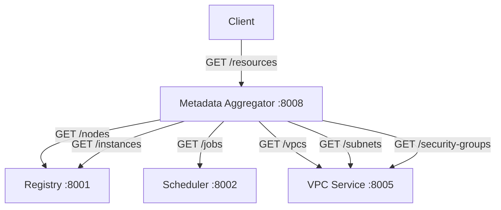

## The problem with distributed state

tiny-aws spreads state across multiple services. The registry knows about nodes
and instances. The scheduler knows about jobs. The VPC service knows about
networks and security groups. Each owns its own SQLite database and HTTP API.

If you want to see the entire system, you have to query each service
individually. The metadata aggregator solves this with brute force: fan out to
every service, collect responses, merge into one JSON object.

## The entire service

`metadata/main.go` is roughly 70 lines. Here is the handler:

```go
func handleResources(w http.ResponseWriter, r *http.Request) {
    resources := map[string]any{}

    if data, err := fetch(registryURL + "/nodes"); err == nil {
        resources["nodes"] = data
    }
    if data, err := fetch(registryURL + "/instances"); err == nil {
        resources["instances"] = data
    }
    if data, err := fetch(schedulerURL + "/jobs"); err == nil {
        resources["jobs"] = data
    }
    if data, err := fetch(vpcURL + "/vpcs"); err == nil {
        resources["vpcs"] = data
    }
    if data, err := fetch(vpcURL + "/subnets"); err == nil {
        resources["subnets"] = data
    }
    if data, err := fetch(vpcURL + "/security-groups"); err == nil {
        resources["security_groups"] = data
    }

    w.Header().Set("Content-Type", "application/json")
    json.NewEncoder(w).Encode(resources)
}
```

Six HTTP calls. One merged response.

## The fetch helper

```go
func fetch(url string) (any, error) {
    resp, err := http.Get(url)
    if err != nil {
        return nil, err
    }
    defer resp.Body.Close()

    if resp.StatusCode != http.StatusOK {
        return nil, fmt.Errorf("upstream returned %d", resp.StatusCode)
    }

    var result any
    if err := json.NewDecoder(resp.Body).Decode(&result); err != nil {
        return nil, err
    }
    return result, nil
}
```

Decode into untyped `any`. The aggregator does not know or care about the shape
of the data -- nodes, jobs, VPCs are all just JSON values placed under their
respective keys.

## The main function

```go
func main() {
    registryURL  = envOr("REGISTRY_URL",  "http://localhost:8001")
    schedulerURL = envOr("SCHEDULER_URL", "http://localhost:8002")
    vpcURL       = envOr("VPC_URL",       "http://localhost:8005")

    port := envOr("PORT", "8008")
    mux := http.NewServeMux()
    mux.HandleFunc("/resources", handleResources)
    log.Printf("metadata aggregator listening on :%s", port)
    log.Fatal(http.ListenAndServe(":"+port, mux))
}
```

One endpoint. Three upstream URLs. No database. No background goroutines.

## Error handling

When a service is down, its key is missing from the response:

```go
if data, err := fetch(schedulerURL + "/jobs"); err == nil {
    resources["jobs"] = data
}
// If fetch fails, "jobs" is absent from resources
```

No error array, no partial-failure indicator. Five keys instead of six means
one service is not responding. The aggregator always returns 200 with whatever
data it could collect.

## The architecture



## Performance

Six sequential HTTP calls means latency is the sum of all upstream latencies.
A parallel fan-out would reduce it to the slowest upstream:

```go
var wg sync.WaitGroup
var mu sync.Mutex

collect := func(key, url string) {
    defer wg.Done()
    if data, err := fetch(url); err == nil {
        mu.Lock()
        resources[key] = data
        mu.Unlock()
    }
}

wg.Add(6)
go collect("nodes", registryURL+"/nodes")
go collect("instances", registryURL+"/instances")
go collect("jobs", schedulerURL+"/jobs")
go collect("vpcs", vpcURL+"/vpcs")
go collect("subnets", vpcURL+"/subnets")
go collect("security_groups", vpcURL+"/security-groups")
wg.Wait()
```

The current implementation does not do this. Simplicity won over performance.

## What real systems do

AWS Config aggregates resource state across services and accounts. Resource
Groups enable tagging and cross-type queries. CloudFormation tracks stacks
spanning dozens of services. They all solve the same problem -- distributed
state queried through a single interface -- with caching, event-driven updates,
and eventually-consistent indexes.

tiny-aws skips all of that. Read-through fan-out on every request.

No caching, no state. One API call, six HTTP requests, one JSON response.
That is the entire service.
