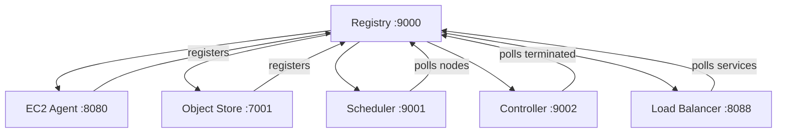

Everything we've described so far is code. Now we run it.

---

## Prerequisites

tiny-aws is built in Go and Rust. The control plane (registry, scheduler, controller, CLI) is Go. The data plane (ec2-agent, object-store) is Rust. You need Go 1.21+, Rust stable (via `rustup.rs`), cmake, debootstrap, unzip, netcat, systemd-nspawn (245+), and iptables.

On Debian/Ubuntu:

```bash
sudo apt install -y build-essential cmake debootstrap unzip netcat-openbsd \
    systemd-container iptables
```

Install Go from `go.dev` and Rust from `rustup.rs` — distribution packages lag behind.

---

## Building the Rust crates

The two Rust projects live in `ec2-agent/` and `object-store/`. Each is a standalone Cargo workspace.

```bash
cd ec2-agent && cargo build
cd ../object-store && cargo build
```

First build takes 2-5 minutes. Subsequent builds are incremental and fast. The binaries land in `target/debug/ec2-agent` and `target/debug/object-store`. For release builds, use `cargo build --release`.

---

## Bootstrapping the root filesystem

Every tiny-aws instance needs a Linux root filesystem. `bootstrap-rootfs.sh` creates one using debootstrap:

```bash
sudo ./scripts/bootstrap-rootfs.sh
```

What it does:

1. Runs `debootstrap --include=systemd,dbus,curl,unzip,python3,nodejs` targeting Debian stable
2. Writes the result to `/var/lib/tinyaws/base`
3. Configures systemd inside the rootfs (enables networking, sets a root password)
4. Creates the overlay directory structure: `/var/lib/tinyaws/overlays/`

This takes 3-5 minutes, needs internet, and only runs once. After that, every instance gets its own overlay on top of this base.

You can target Ubuntu instead: `sudo ./scripts/bootstrap-rootfs.sh --distro ubuntu --release jammy`. Default is Debian bookworm.

---

## Configuration

Copy the example environment file:

```bash
cp .env.example .env.local
```

Key variables:

```bash
# API authentication
TINYAWS_API_KEY=your-secret-key-here

# Agent networking
AGENT_ADVERTISE_ADDR=127.0.0.1
AGENT_PORT=8080

# Service URLs (used by agent and scheduler to find each other)
REGISTRY_URL=http://127.0.0.1:9000
SCHEDULER_URL=http://127.0.0.1:9001
OBJECT_STORE_URL=http://127.0.0.1:7001

# Storage paths
TINYAWS_BASE_ROOTFS=/var/lib/tinyaws/base
TINYAWS_OVERLAY_DIR=/var/lib/tinyaws/overlays
TINYAWS_SECCOMP_PROFILE=./seccomp-default.json

# Object store data directory
OBJECT_STORE_DATA_DIR=/var/lib/tinyaws/objects
```

`AGENT_ADVERTISE_ADDR` is the IP other services use to reach this agent. On a single machine, `127.0.0.1` works. On a multi-machine setup, it must be the machine's real IP. This comes up again in Chapter 41.

---

## Startup order

This matters. Services depend on each other, and the dependency graph has a strict root.

```bash
./scripts/run-local.sh
```

The script starts services in this order:

### 1. Registry (:9000)

Everything else depends on the registry. It's the service discovery layer. Agents register with it. The scheduler polls it. The load balancer polls it. If the registry isn't running, nothing can find anything.

### 2. EC2 Agent (:8080)

The agent starts, registers with the registry at `REGISTRY_URL`, and begins heartbeating every 10 seconds. It manages instances on this machine — creating containers, running deployments, reporting health.

### 3. Object Store (:7001)

The S3-compatible storage service. Registers with the registry as a storage node. Stores deployment artifacts, user objects, anything uploaded via the S3 API.

### 4. Scheduler (:9001)

Polls the registry for healthy agent nodes. When a launch request comes in, it picks an agent using round-robin and forwards the request. Without healthy agents in the registry, it has nothing to schedule onto.

### 5. Controller (:9002)

Polls the registry for instances marked as terminated. Handles cleanup — removing overlays, releasing IPs, deregistering services. It's the garbage collector.

### 6. Load Balancer (:8088)

Polls the registry for services with health checks passing. Routes incoming HTTP requests to healthy backends. It's the last to start because it needs services to already be registered.



The registry is the root. Every arrow points from or to it.

Between each startup, `run-local.sh` waits for the port to be listening before proceeding:

```bash
wait_for_port() {
    local port=$1
    local retries=30
    while ! nc -z 127.0.0.1 "$port" 2>/dev/null; do
        retries=$((retries - 1))
        if [ "$retries" -le 0 ]; then
            echo "Timed out waiting for port $port"
            exit 1
        fi
        sleep 1
    done
}
```

---

## The PID file

`run-local.sh` writes every background process ID to `/tmp/tinyaws-pids`. The corresponding `stop-local.sh` reads this file and sends SIGTERM to each PID in reverse order — load balancer first, registry last.

```bash
# stop-local.sh
tac /tmp/tinyaws-pids | while read pid; do
    kill "$pid" 2>/dev/null
done
rm -f /tmp/tinyaws-pids
```

Reverse order matters. Stopping the registry first would cause every other service to lose its registration endpoint and log errors during shutdown.

---

## systemd unit

For auto-start on boot:

```ini
# /etc/systemd/system/tinyaws.service
[Unit]
Description=tiny-aws cloud platform
After=network-online.target
Wants=network-online.target

[Service]
Type=forking
EnvironmentFile=/etc/tinyaws/env
ExecStart=/opt/tinyaws/scripts/run-local.sh
ExecStop=/opt/tinyaws/scripts/stop-local.sh
PIDFile=/tmp/tinyaws-pids
Restart=on-failure
RestartSec=5

[Install]
WantedBy=multi-user.target
```

```bash
sudo systemctl enable --now tinyaws.service
```

---

## CLI installation

The CLI is a Go binary:

```bash
cd control-plane/cli && go install .
```

This puts `tinyaws` in your `$GOPATH/bin`. The CLI reads `TINYAWS_API_KEY` and `REGISTRY_URL` from environment variables or `~/.tinyaws/config.json`.

---

## Verification

`smoke-test.sh` runs 10 checks in sequence. Each check is auth-aware — it passes the API key from `.env.local`.

```bash
./scripts/smoke-test.sh
```

What it checks:

1. Registry is responding on :9000
2. At least one agent is registered (`GET /nodes`)
3. Object store is responding on :7001
4. Scheduler is responding on :9001
5. Controller is responding on :9002
6. Load balancer is responding on :8088
7. Can launch an instance (`POST /instances`)
8. Instance reaches "running" state within 30 seconds
9. Can upload an object (`PUT /objects/test-key`)
10. Can terminate the instance (`DELETE /instances/<id>`)

If any step fails, the script prints the failing check, the HTTP response, and the service's last 20 log lines. Most failures come down to two things: a service isn't running, or a URL is wrong.

---

Start the registry. Start the agent. Start everything else. That's the order. If something doesn't connect, check that the registry is up and the URLs are right.
