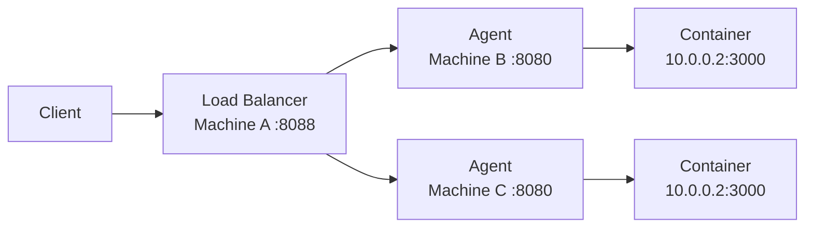

So far, everything runs on one machine. That's fine for learning. But a cloud with one machine isn't really a cloud.

This chapter splits tiny-aws across multiple machines. The control plane stays on one. Agents run on others. The changes are smaller than you'd expect.

---

## The split

**Machine A** runs the control plane: registry, scheduler, controller, load balancer, object store. This is the brain. It doesn't run any user instances.

**Machine B and C** run only the EC2 agent. They register with the control plane, receive instance launch requests, and run containers. These are the workers.

In a production cloud, the control plane would itself be distributed and replicated. In tiny-aws, it's a single point of failure. That's fine for what we're building.

---

## Machine A: control plane

Run the full stack as before, with one change — services must listen on all interfaces, not just localhost:

```bash
# .env.local on Machine A
TINYAWS_API_KEY=your-secret-key-here

AGENT_ADVERTISE_ADDR=192.168.1.10
AGENT_PORT=8080

REGISTRY_URL=http://0.0.0.0:9000
SCHEDULER_URL=http://0.0.0.0:9001
OBJECT_STORE_ADDR=0.0.0.0:7001
OBJECT_STORE_URL=http://192.168.1.10:7001

TINYAWS_BASE_ROOTFS=/var/lib/tinyaws/base
TINYAWS_OVERLAY_DIR=/var/lib/tinyaws/overlays
```

The critical change: `0.0.0.0` instead of `127.0.0.1` for listen addresses. Without this, services only accept connections from localhost, and remote agents can't reach them.

`OBJECT_STORE_URL` must be the real IP (`192.168.1.10`), not `0.0.0.0`. This URL is given to agents so they can download deployment artifacts. They need a routable address.

```bash
./scripts/run-local.sh
```

Verify the registry is accessible from the network:

```bash
# From Machine B
curl http://192.168.1.10:9000/nodes
```

---

## Machine B/C: agent only

No control plane. No object store. Just the agent.

First, run `bootstrap-rootfs.sh` on each machine. The base rootfs is not shared — each machine needs its own copy. This is a one-time step per machine.

```bash
sudo ./scripts/bootstrap-rootfs.sh
```

Then start the agent with four environment variables:

```bash
export REGISTRY_URL=http://192.168.1.10:9000
export SCHEDULER_URL=http://192.168.1.10:9001
export OBJECT_STORE_URL=http://192.168.1.10:7001
export AGENT_ADVERTISE_ADDR=192.168.1.11

./target/debug/ec2-agent
```

That's it. The agent starts, registers with the registry, and begins heartbeating.

On Machine C, same thing with its own IP:

```bash
export REGISTRY_URL=http://192.168.1.10:9000
export SCHEDULER_URL=http://192.168.1.10:9001
export OBJECT_STORE_URL=http://192.168.1.10:7001
export AGENT_ADVERTISE_ADDR=192.168.1.12

./target/debug/ec2-agent
```

Check the registry from Machine A:

```bash
curl http://192.168.1.10:9000/nodes
```

```json
{
  "nodes": [
    {"addr": "192.168.1.10:8080", "status": "healthy", "last_heartbeat": "..."},
    {"addr": "192.168.1.11:8080", "status": "healthy", "last_heartbeat": "..."},
    {"addr": "192.168.1.12:8080", "status": "healthy", "last_heartbeat": "..."}
  ]
}
```

Three nodes. One cluster.

---

## Why AGENT_ADVERTISE_ADDR matters

The agent needs to tell the registry how other services can reach it. Using the machine's hostname is unreliable — it might resolve to `127.0.0.1` via `/etc/hosts`, or to an internal DNS name that other machines can't resolve, or to the wrong interface on a multi-homed host.

`AGENT_ADVERTISE_ADDR` is the explicit answer: "This is the IP that other machines should use to talk to me." The agent registers this address with the registry. The scheduler uses it to forward launch requests. The load balancer uses it to route traffic to services on this node.

If you get this wrong, everything registers fine, but nothing can actually connect. The registry shows healthy nodes, the scheduler assigns work, and then the request fails with a connection timeout because the advertised address doesn't route.

---

## What changes versus single-machine

Almost nothing at the API level. The CLI still talks to the scheduler. The scheduler still picks agents from the registry. Deployments still upload to the object store and deploy to instances. The commands are identical:

```bash
tinyaws instance launch --type small
tinyaws deploy ./my-app --service --port 3000
```

The scheduler might place the instance on Machine B instead of Machine A. The CLI doesn't know or care.

---

## Job distribution

The scheduler uses round-robin across healthy agents. If three agents are registered:

| Launch request | Agent selected |
|----------------|----------------|
| 1st | 192.168.1.10 |
| 2nd | 192.168.1.11 |
| 3rd | 192.168.1.12 |
| 4th | 192.168.1.10 |

If an agent becomes unhealthy (heartbeat stops, registry marks it down), the scheduler skips it. When it recovers and the heartbeat resumes, the scheduler includes it again.

There's no load-aware scheduling. The scheduler doesn't know how many instances each agent is running or how much CPU is free. It just goes around the circle. This is a known simplification — real schedulers (Kubernetes, Nomad, Borg) use resource-aware bin-packing.

---

## Load balancer routing across machines

The load balancer discovers services by polling the registry. Each service entry includes the instance's IP — which is the container's IP on the agent's bridge network.

For single-machine setups, the load balancer can reach container IPs directly because they're on the same bridge. For multi-machine setups, container IPs are local to each machine's bridge — `10.0.0.2` on Machine B is not reachable from Machine A.

tiny-aws handles this by routing through the agent. The load balancer uses the agent's advertised address and a mapped port to reach services on remote nodes. The agent forwards traffic from its host interface to the container's bridge interface.



Each machine has its own `tinyaws0` bridge with its own `10.0.0.0/16` space. The IPs can overlap because they're in different network namespaces on different machines. The agent's port forwarding resolves the overlap by exposing each service on a unique host port.

---

## What doesn't transfer between machines

**The base rootfs.** `bootstrap-rootfs.sh` must be run on each machine separately. There's no mechanism to distribute it. Each agent needs its own copy at `/var/lib/tinyaws/base`.

**Overlay filesystems.** Instance state lives in overlays on the machine where the instance runs. There's no live migration — you can't move a running instance from Machine B to Machine C. Terminating on B and launching on C is the only option.

**Object store data.** The object store runs on Machine A only. If Machine A goes down, no deployments can be downloaded. In a real cloud, storage would be replicated. In tiny-aws, it's single-node.

---

## Network requirements

The machines need to reach each other on these ports:

| Port | Service | Direction |
|------|---------|-----------|
| 9000 | Registry | Agents --> Control plane |
| 9001 | Scheduler | CLI --> Control plane |
| 7001 | Object Store | Agents --> Control plane |
| 8080 | Agent | Control plane --> Agents |
| 8088 | Load Balancer | Clients --> Control plane |

If you're on a local network, these are usually open. If you're crossing firewalls or cloud security groups, open them explicitly.

---

## A minimal two-machine setup

The simplest real cluster:

**Machine A (control plane + agent):**

```bash
# Start everything
./scripts/run-local.sh
```

**Machine B (agent only):**

```bash
export REGISTRY_URL=http://<machine-a-ip>:9000
export SCHEDULER_URL=http://<machine-a-ip>:9001
export OBJECT_STORE_URL=http://<machine-a-ip>:7001
export AGENT_ADVERTISE_ADDR=<machine-b-ip>

sudo ./scripts/bootstrap-rootfs.sh   # one-time
./target/debug/ec2-agent
```

Verify:

```bash
curl http://<machine-a-ip>:9000/nodes   # should show 2 agents
tinyaws instance launch --type small     # may land on either machine
tinyaws instance list                    # shows which agent got it
```

---

Add a machine, export four env vars, start the agent. It registers, starts heartbeating, and picks up work. That's multi-machine.
