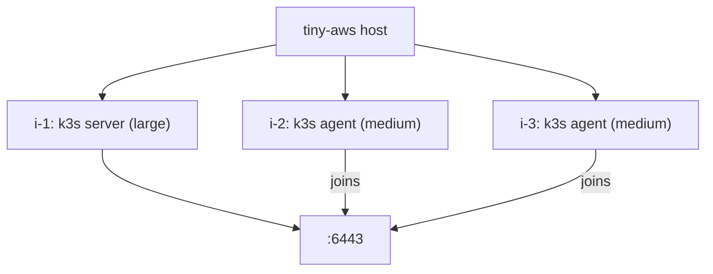

You built a cloud. Now run a container orchestrator on top of it.

This chapter deploys k3s — a lightweight Kubernetes distribution — inside tiny-aws instances. Each instance is a systemd-nspawn container with its own systemd, network stack, and cgroup limits. k3s doesn't know it's not on bare metal.

---

## What you're building

One k3s server node and N workers. Each node is a tiny-aws instance.



---

## The deploy script

`examples/kubernetes/deploy-cluster.sh` automates this. You can run it directly or follow the steps below manually.

```bash
./examples/kubernetes/deploy-cluster.sh --workers 2
```

The script does everything described in this chapter. Running it manually is more instructive.

---

## Step 1: Launch the server instance

The k3s server needs resources. Use a large instance (400% CPU, 2GB RAM):

```bash
tinyaws instance launch --type large --name k3s-server
tinyaws instance list
```

```
ID    TYPE    STATUS    IP          NAME
i-1   large   running   10.0.0.2    k3s-server
```

---

## Step 2: Install k3s server

```bash
tinyaws instance shell i-1
```

Inside the container:

```bash
curl -sfL https://get.k3s.io | sh -s - server \
    --disable traefik \
    --disable servicelb \
    --write-kubeconfig-mode 644
```

`--disable traefik` and `--disable servicelb` skip components that need features nspawn containers don't have. k3s works fine without them. Once k3s is up:

```bash
kubectl get nodes
```

```
NAME   STATUS   ROLES                  AGE   VERSION
i-1    Ready    control-plane,master   30s   v1.28.x+k3s1
```

---

## Step 3: Extract the join token

```bash
cat /var/lib/rancher/k3s/server/node-token
```

Copy this token and note the server's IP (`10.0.0.2`). Workers need both. Exit the shell.

---

## Step 4: Launch worker instances

Medium instances (200% CPU, 1GB RAM):

```bash
tinyaws instance launch --type medium --name k3s-worker-1
tinyaws instance launch --type medium --name k3s-worker-2
```

---

## Step 5: Install k3s agent on each worker

Shell into each worker and install k3s in agent mode:

```bash
tinyaws instance shell i-2
curl -sfL https://get.k3s.io | K3S_URL=https://10.0.0.2:6443 \
    K3S_TOKEN="<token-from-step-3>" \
    sh -s - agent
exit
```

Repeat for `i-3` with the same token and URL.

---

## Verify the cluster

```bash
tinyaws instance shell i-1
kubectl get nodes
```

```
NAME   STATUS   ROLES                  AGE     VERSION
i-1    Ready    control-plane,master   3m      v1.28.x+k3s1
i-2    Ready    <none>                 1m      v1.28.x+k3s1
i-3    Ready    <none>                 45s     v1.28.x+k3s1
```

Three nodes, all Ready.

---

## Running workloads

From inside the server instance:

```bash
kubectl run nginx --image=nginx --port=80
kubectl get pods -o wide
```

```
NAME    READY   STATUS    RESTARTS   AGE   IP           NODE
nginx   1/1     Running   0          10s   10.42.0.5    i-2
```

The pod landed on worker `i-2`. Expose it:

```bash
kubectl expose pod nginx --port=80 --type=NodePort
kubectl get svc nginx
```

From the host, reach it through the container's IP and the assigned NodePort:

```bash
curl http://10.0.0.3:31234
```

---

## Elastic scaling

Need more capacity? Launch another instance and join it:

```bash
tinyaws instance launch --type medium --name k3s-worker-3
tinyaws instance shell i-4
curl -sfL https://get.k3s.io | K3S_URL=https://10.0.0.2:6443 \
    K3S_TOKEN="<token>" sh -s - agent
```

Four nodes. Kubernetes immediately schedules pods to the new worker if there's demand.

---

## Tear down

Terminate each instance:

```bash
tinyaws instance terminate i-4
tinyaws instance terminate i-3
tinyaws instance terminate i-2
tinyaws instance terminate i-1
```

As each worker is terminated, k3s marks it `NotReady` and reschedules its pods. When the server is terminated, the cluster ceases to exist. The overlay filesystems are removed on termination.

---

## Why this works

k3s requires:

- A Linux system with systemd
- Network connectivity between nodes
- Cgroups for resource accounting
- A writable filesystem

tiny-aws instances provide all of these. Each instance is a systemd-nspawn container with:

- Real systemd as PID 1 (not a stub — full systemd with journald, networkd, resolved)
- A network interface on the `tinyaws0` bridge, with IP connectivity between containers
- Cgroups v2 with CPU and memory limits
- An overlayfs with a writable upper layer

k3s doesn't inspect whether it's running on bare metal, in a VM, or in a container. It checks for systemd, checks for cgroups, opens network sockets, and starts. The abstraction holds.

---

A Kubernetes cluster running on a cloud you built from scratch. Each container is a real isolated Linux system. The orchestrator doesn't know it's not on bare metal. That's the point.
