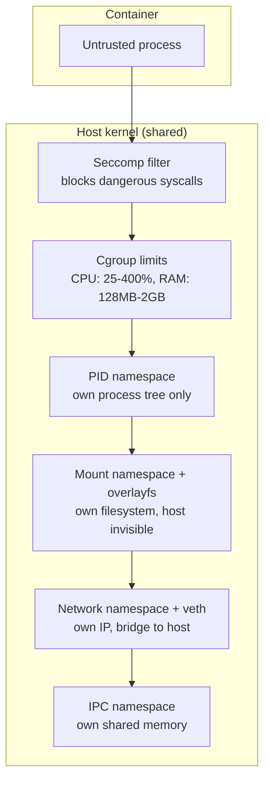

An AI agent needs to run code. Code it wrote itself. On your machine. That's a trust problem.

The same problem applies to CI runners, code execution playgrounds, student homework graders, and any system that runs code from an external source. The code is untrusted. It might be malicious. It might be buggy in ways that look like malice. Either way, you need isolation.

tiny-aws provides that isolation using the same Linux primitives that Docker, Firecracker, and gVisor build on. This chapter explains how to use it as a sandbox and where its limits are.

---

## The isolation stack

When tiny-aws launches an instance, the resulting container is isolated on six axes:

**PID namespace.** The process can only see processes inside its own container. `ps aux` shows the container's process tree, not the host's. It cannot send signals to host processes. It cannot read `/proc/<pid>` for any host PID.

**Mount namespace + overlayfs + pivot_root.** The process has its own root filesystem — an overlay on top of the base rootfs. It cannot see the host filesystem. There is no bind mount to the host's `/`. The pivot_root call makes the overlay the new root, and the old root is unmounted.

**IPC namespace.** Shared memory segments, message queues, and semaphores are isolated. A process in the container cannot attach to shared memory created on the host or in another container.

**Cgroups.** CPU and memory are capped. A container with a 512MB memory limit gets OOM-killed if it exceeds that — not the host, not other containers. A container with 100% CPU quota can use one core, no more. Even a fork bomb is contained: it fills the CPU quota and stops.

**Seccomp.** The seccomp profile blocks dangerous syscalls — `reboot`, `kexec_load`, `init_module`, `ptrace`, and others. The process gets `EPERM` on blocked calls instead of being killed, so it can handle errors gracefully.

**Network namespace + veth.** The container has its own network interface on the `tinyaws0` bridge. It has its own IP. It can make outbound connections (NAT'd through the host). It cannot sniff traffic from other containers or the host.

---

## Running commands in a sandbox

### Launch and exec

The simplest pattern: launch an instance, run a command, read the output.

```bash
tinyaws instance launch --type nano
tinyaws exec i-1 -- python3 -c "print(2 + 2)"
```

Output:

```
4
```

The command runs inside the container with full isolation. When it exits, the instance is still running — you can exec more commands into it.

### Interactive shell

```bash
tinyaws instance shell i-1
```

This opens an interactive shell via `machinectl shell`. You're inside the container. Everything you type runs in the sandbox.

### One-shot execution

For CI-style workloads — run something, capture output, throw away the instance:

```bash
tinyaws instance launch --type small
tinyaws exec i-1 -- bash -c 'cd /tmp && curl -sO https://example.com/script.sh && bash script.sh'
tinyaws instance terminate i-1
```

---

## Instance types for sandboxing

Different workloads need different resource budgets:

| Type | CPU | Memory | Use case |
|------|-----|--------|----------|
| nano | 25% (quarter core) | 128 MB | Short scripts, simple calculations |
| micro | 50% (half core) | 256 MB | API calls, light processing |
| small | 100% (one core) | 512 MB | Build tasks, longer computations |
| medium | 200% (two cores) | 1 GB | Compilation, data processing |
| large | 400% (four cores) | 2 GB | Heavy workloads, multiple processes |

For AI agent sandboxing, `nano` or `micro` is usually enough. The agent is running a short script — a few Python lines, a curl command, a file transformation. It doesn't need a gigabyte of RAM or four cores.

The cgroup limits are hard limits. A `nano` instance that tries to allocate 200MB of RAM gets OOM-killed. A `nano` instance that tries to spin up 8 threads gets throttled to 25% of a core. The limits are enforced by the kernel, not by the application.

---

## The isolation stack, visualized



Each layer catches a different attack vector. A process that escapes PID isolation still hits mount isolation. A process that escapes mount isolation still hits seccomp. Defense in depth.

---

## What is NOT isolated

The isolation is real but not absolute. Understanding the gaps is as important as understanding the layers.

**Shared kernel.** Every container shares the host kernel. A kernel exploit in any container compromises the host and every other container. This is the fundamental limitation of container-based isolation. The only fix is a hardware hypervisor — a separate kernel per tenant (Firecracker, QEMU/KVM). tiny-aws uses `systemd-nspawn`, which is containers, not VMs.

**No hardware virtualization.** There is no CPU virtualization ring (VT-x), no IOMMU, no separate page tables. The kernel enforces isolation through software checks. A kernel bug that skips a check breaks isolation.

**Seccomp profile is a denylist.** tiny-aws blocks known-dangerous syscalls but allows everything else. New syscalls or obscure attack vectors might not be covered. A production sandbox would use an allowlist — permit only ~150 known-safe syscalls, deny everything else.

**No GPU isolation.** If the host has a GPU and you pass it through, there's no per-container GPU memory limit in tiny-aws.

**Timing side channels.** Containers share the CPU cache, branch predictor, and memory bus. Spectre-class attacks can potentially leak data across containers sharing a physical core. Mitigations exist at the OS level but tiny-aws doesn't configure them.

---

## Comparison with other sandboxes

| | tiny-aws | Docker | Firecracker | gVisor |
|---|---|---|---|---|
| **Isolation mechanism** | systemd-nspawn (namespaces + cgroups) | namespaces + cgroups | hardware VM (KVM) | user-space kernel |
| **Kernel shared?** | Yes | Yes | No (guest kernel) | Partially (Sentry intercepts syscalls) |
| **Startup time** | ~1s | ~0.5s | ~125ms | ~0.5s |
| **Memory overhead** | ~10MB | ~10MB | ~5MB + guest kernel | ~20MB |
| **Syscall filtering** | seccomp denylist | seccomp allowlist | N/A (guest kernel) | Sentry re-implements syscalls |
| **Escape difficulty** | Kernel exploit | Kernel exploit | Hypervisor exploit | Sentry exploit + kernel exploit |
| **Use case** | Educational, light sandboxing | Production containers | AWS Lambda, Fargate | Google Cloud Run |

**Docker** uses the same Linux primitives as tiny-aws — namespaces, cgroups, seccomp — with a more mature and audited configuration. Docker's default seccomp profile is an allowlist of ~300 syscalls. Docker also uses AppArmor or SELinux for additional MAC (mandatory access control) enforcement.

**Firecracker** runs each sandbox in a lightweight VM with its own Linux kernel. A compromised guest kernel can't touch the host because the hypervisor (KVM) enforces hardware isolation. This is what AWS Lambda uses. The trade-off is complexity: you need KVM support, a guest kernel image, and a rootfs in a different format.

**gVisor** interposes a user-space kernel (called Sentry) between the container and the host kernel. Application syscalls go to Sentry, which re-implements them in user space. Only a small set of host syscalls are actually made. This dramatically reduces the kernel attack surface. The trade-off is compatibility: some syscalls behave differently in gVisor than in Linux.

---

## Practical patterns for agent sandboxing

### Pattern 1: Ephemeral instance per task

```bash
# Agent decides to run code
ID=$(tinyaws instance launch --type nano --quiet)
RESULT=$(tinyaws exec "$ID" -- python3 -c "$AGENT_CODE")
tinyaws instance terminate "$ID"
```

Clean isolation per task. ~1 second overhead for launch + terminate. Good for agents that run infrequent commands.

### Pattern 2: Persistent instance with exec

```bash
# Launch once at session start
ID=$(tinyaws instance launch --type small --quiet)

# Agent runs multiple commands
tinyaws exec "$ID" -- pip install requests
tinyaws exec "$ID" -- python3 script.py
tinyaws exec "$ID" -- cat /tmp/output.json

# Terminate at session end
tinyaws instance terminate "$ID"
```

Lower overhead per command. State persists between execs (installed packages, files). Good for agents that run many commands in a session.

### Pattern 3: Pre-warmed pool

```bash
# Pre-launch a pool of instances
for i in $(seq 1 5); do
    tinyaws instance launch --type micro --quiet
done

# Assign instances to tasks from the pool
# Terminate and replace after each task
```

Eliminates launch latency. Good for high-throughput execution services.

---

## Timeouts and resource limits

For untrusted code, resource limits are not optional. A script that runs `while True: pass` will consume its full CPU quota forever unless you stop it.

tiny-aws provides cgroup limits for CPU and memory. For execution time limits, use `timeout` inside the exec:

```bash
tinyaws exec i-1 -- timeout 30 python3 script.py
```

This kills the process after 30 seconds regardless of what it's doing. Combine with instance-level limits:

- `nano` (128MB RAM) prevents memory-based denial of service
- `timeout` prevents CPU-based denial of service
- Seccomp prevents syscall-based attacks
- Network namespace prevents network-based attacks on the host

---

tiny-aws isn't a production sandbox. But it demonstrates the real primitives — the same ones Docker, Firecracker, and gVisor build on. Understanding these layers is understanding container security.
